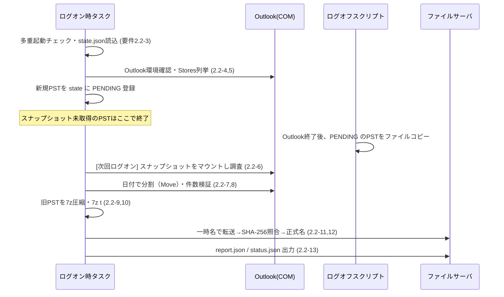
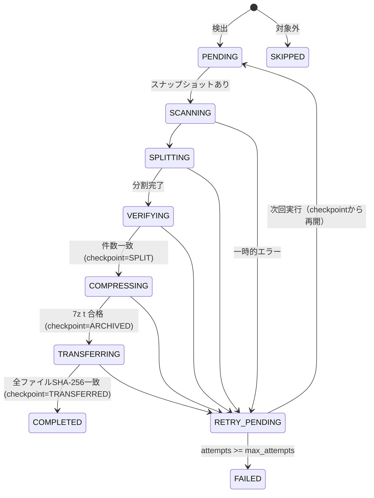
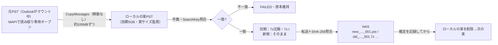

# PSTメールアーカイブ自動収集ツール 設計書

- 文書版数：1.1（大容量PST向けのライブ分割方式 §16 を追加）
- 対象要件：[requirements.md](requirements.md) 版数1.0
- システム名：PSTMigration

---

# 1. 本書の位置づけ

要件定義書（以下「要件」）を実装可能な粒度に落とし込む。特に要件「10. 未決定事項」のうち、実装方式に直結する 10.1（PST処理方式）・10.2（一時ディスク容量）・10.3（実行時間帯）について本書で方式を提案し、確定させる。

## 1.1 既存スクリプト Split-PstByDate.ps1 の扱い

当初は PowerShell スクリプト `Split-PstByDate.ps1` で「新旧PSTへ分割 → 旧PSTをファイルサーバへ永久保存」する計画だったが、要件変更に伴い **本スクリプトは廃止** し、Python製EXEとして再設計する。

## 1.2 本ツールのゴール

本ツールの役目は、**旧メール（7z）と新メール（PST）の両方を、ファイルサーバ `\\192.168.8.120\PSTBackup` に後続作業しやすい形で揃えること** までとする。

| 出力 | 本ツールの到達点 | 後続作業（担当者が別途手作業で実施、スコープ外） |
|---|---|---|
| 旧メール `old_mail_before_{cutoff日付}_{PC名}.7z` | ファイルサーバに配置・ハッシュ検証済み | SharePoint Online へ移す |
| 新メール `new_mail_from_{cutoff日付}_{PC名}.pst` | ファイルサーバに配置・ハッシュ検証済み | AzCopy でアップロードし Purview で Exchange Online へインポート |

`{cutoff日付}` は config の `cutoff`（§12）の日付（例 `20160221`）。ライブ分割方式（§16）では束ごとに `_001`, `_002` … を付ける。

後続作業を楽にするため、保存先の構造（§8.2）と管理者向け集計出力（§11.4）をそれに合わせて設計する。

既存スクリプトから得た知見と、そのまま流用できない理由：

| 既存実装 | 問題点 | 本設計での対応 |
|---|---|---|
| 元PST上で `MailItem.Copy()` → `Move()` | 元PSTに一時アイテムが作られる。Move失敗時は元PSTの削除済みアイテムにゴミが残る。FR-03違反 | 元PSTには一切書き込まない。スナップショット（ファイルコピー）上で処理する（§4） |
| `Documents\Outlook ファイル` 配下を再帰検索 | FR-01（Outlook Storesから検出）と不一致。保存場所依存 | `Namespace.Stores` から検出（§3） |
| `MailItem.Sent` で送受信を判定 | 受信メールも `Sent = True` になるため、常にSentOn優先になっている | MAPIプロパティで送受信を判定（§5.2） |
| `Class -ne olMail` を全てスキップ | 会議出席依頼・配信通知などが黙って除外される。FR-02違反 | メールフォルダー内のアイテムは原則すべて分割対象（§5.1） |
| アイテムごとにOOMプロパティ参照 | 大容量PSTで低速 | `Folder.GetTable()` で一括走査（§5.3） |
| 出力ファイル名の衝突回避がPC内のみ | 複数PC・同名PSTでサーバ上衝突 | PC名＋パスハッシュでフォルダー分離（§8.2） |

---

# 2. 全体構成

## 2.1 実行形態

1つのEXE `PSTMigration.exe` を、起動引数で3つのモードに切り替える。

| モード | 起動契機 | 起動方法 | 主な処理 | Outlook |
|---|---|---|---|---|
| 通常（引数なし） | ログオン後（遅延） | GPP スケジュールタスク | 検出・調査・分割・圧縮・転送・報告。ライブ分割（§16）もこのモードで行う | 使用（ライブ分割の元PSTは MAPI の別セッション） |
| `--snapshot` | ログオフ時 | GPO ログオフスクリプト | 元PSTのファイルスナップショット取得 | 不使用 |
| `--aggregate <root>` | 管理者が手動 | 管理者PCから実行 | サーバ上の status.json を集約し、移行台帳と後続作業向けCSVを `_admin\` に出力（§11.4） | 不使用 |

補助：`--scan-only`（分割せず件数調査のみ。試験・パイロット用。ライブ分割も行わない）、`--reset <pst_key>`（§9.3）、`--config <path>`、`--version`。

PSTごとに処理方式を選ぶ（§16.3）。

- **スナップショット方式（§4〜§9）**：ログオフ時のコピー上限以内で、空きも足りるPST。ログオフ時にスナップショットを取る理由は §4 を参照。1つのPSTは「ログオン（検出）→ ログオフ（スナップショット）→ 次回ログオン（分割〜転送）」の最短2回のログオンで完了する。
- **ライブ分割方式（§16）**：上限を超える、または空きが足りないPST。ログオン時に元PSTを読み取り専用で開き、束ごとに作成〜転送する。1回のログオンで完了しうる。

## 2.2 配置

```
%LOCALAPPDATA%\PSTMigration\
    bin\                  GPPファイルで配布（§10.1）
        PSTMigration.exe  7-Zip CLI（7z.exe / 7z.dll）を内蔵。各PCへの7-Zipインストール不要
        config.json
        PSTMigration-manual.cmd / .ps1   手動実行用
        7-Zip-License.txt
    state.json            PST単位の処理状態（§9）
    logs\
        run-YYYYMMDD-HHMMSS-{PID}.jsonl
    reports\              完了したPSTの report.json
    work\
        {pst_key}\        PSTごとの作業フォルダー（§7。ライブ分割は §16）
        contacts\         連絡先バックアップの作業フォルダー
```

ライブ分割の束PSTは、本ツールが作る一時 MAPI プロファイル `PSTMigration-tmp-{PID}-{連番}`（束PST1つだけ。既定プロファイルにはしない）で開き、閉じるときに削除する（§16.5.1）。

`work_dir` は config で変更可能（システムドライブが小さいPC向け）。OneDriveリダイレクト配下は不可とする。

## 2.3 処理フロー（要件2.2との対応）



上はスナップショット方式。ライブ分割方式の流れは §16.2。

## 2.4 モジュール構成（Python）

ソースは `src/pstmigration/`。

| モジュール | 責務 |
|---|---|
| `__main__.py` | 引数解析・モード振り分け・多重起動防止・優先度設定・JSONログ |
| `config.py` | config.json 読込・検証 |
| `state.py` | state.json の原子的読み書き、状態遷移（`StepError`） |
| `rules.py` | Outlook非依存の判定（日付分割、PSTヘッダー、容量計算、集計、処理方式の選択） |
| `outlook.py` | Outlook接続、PST検出、マウント／アンマウント、調査、分割、件数検証、連絡先のバックアップ |
| `chunks.py` | ライブ分割の束：範囲・照合・作成〜転送・再開・完了判定・元PSTの変更検知（Outlook非依存） |
| `mapilive.py` | ライブ分割の Extended MAPI：元PSTの読み取り専用オープン、一時プロファイル、移動なしのコピー、束の読み直し |
| `pipeline.py` | ログオフ時スナップショット、ログオン時の段階処理（7-Zip呼び出し含む）、ライブ分割の組み立て |
| `transfer.py` | SMB転送、帯域制御、同時転送枠、SHA-256照合 |
| `report.py` | report.json / status.json、`--aggregate` |

依存ライブラリ：実行時は pywin32 のみ（標準ライブラリ以外）。開発時は pyinstaller・pytest・hypothesis・ruff。テストは `tests/`（統合テストは `tests/integration/`、§16.15）、ビルドは `scripts/build.sh`（Git Bash）または `scripts/build.bat`（cmd）。

---

# 3. PST自動検出（FR-01）

## 3.1 Outlook接続

1. `win32com.client.Dispatch("Outlook.Application")` で接続（起動中ならそのインスタンス、未起動ならバックグラウンド起動）。
2. `Namespace.Logon("", "", False, False)` — プロファイル選択ダイアログを出さず既定プロファイルを使用。
3. 接続不可（New Outlookのみ・Outlook未導入）→ 全体を `SKIPPED`（理由 `OUTLOOK_UNAVAILABLE`）として status.json のみ出力し終了。

COMはプロセス外サーバのため、EXE（64bit）とOutlook（32/64bit）のビット数は一致不要。EXEは64bit版1種類のみ作成する。

## 3.2 検出条件

`Namespace.Stores` の各 Store について、以下をすべて満たすものを対象とする。

| 条件 | 判定方法 |
|---|---|
| ファイル実体がある | `Store.FilePath` が空でない |
| PST形式 | 拡張子 `.pst`（ヘッダーの最終判定は§4.4でスナップショットに対して行う） |
| IMAP/Exchange以外 | `Store.ExchangeStoreType == olNotExchange(3)` かつ拡張子 `.ost` でない |
| 本ツールの生成物でない | パスが `work_dir` 配下でない、かつファイル名が `*_before_YYYYMMDD.pst` / `*_from_YYYYMMDD.pst`（旧スクリプト出力）に一致しない |

- 一致しないStoreは記録のみ（`SKIPPED`、理由付き）。
- 重複排除キーは `os.path.normcase(os.path.realpath(FilePath))`。
- PSTごとに `pst_key = sha256(正規化パス)[:12]` を採番し、以降の識別に使う。
- `Store.IsDataFileStore` / `Namespace.DefaultStore` との一致（既定データファイルか）も記録する（POP→IMAP移行後、旧POPのPSTが既定データファイルのまま残っているケースが多いと想定）。

## 3.3 起動時の後始末

前回異常終了で作業用PST（`work_dir` 配下）がOutlookに接続されたまま残っている場合、検出前に `RemoveStore` で切り離す。

---

# 4. 元PSTの保護とスナップショット（FR-03／未決定事項10.1）

## 4.1 方式比較

| 方式 | 元PSTへの書き込み | Outlook起動中 | 既定データファイル | 業務影響 | 評価 |
|---|---|---|---|---|---|
| A. 元PST上で `MailItem.Copy()` | **あり**（一時アイテム） | 可 | 可 | 小 | FR-03で禁止 |
| B. ログオン中にファイルコピー | なし | **不可**（Outlookがロック。逆に当方がファイルを掴むとOutlookがPSTを開けなくなる） | 不可 | 大 | 不採用 |
| C. ストア切り離し→コピー→再接続 | なし | 可 | **不可**（既定データファイルは切り離せない） | 中（一時的にナビゲーションから消える。異常終了時に切り離されたまま残る） | 不採用 |
| D. `Folder.CopyTo()` で作業PSTへ複製 | なし（要検証） | 可 | 可 | **大**（大きいフォルダーのコピー中、OutlookのUIスレッドが長時間固まる） | 不採用 |
| E. 拡張MAPIで自プロセスから直接読み出し | なし（読み取り専用で開く。実証済み） | 可 | 可 | 小 | 大容量PST向けに §16 で採用（ライブ分割方式）。64bit Office 前提 |
| **F. ログオフ時にファイルコピー** | **なし** | 該当なし（Outlook終了後） | 可 | 小（ログオフが数分延びる、初回のみ） | **採用** |

## 4.2 採用方式：ログオフ時スナップショット

GPOのログオフスクリプトはユーザーのアプリケーション（Outlook含む）終了後に実行されるため、PSTは誰にもロックされておらず、内容も静止している。この時点でファイルコピーを取り、以降の全処理をコピー上で行う。

`PSTMigration.exe --snapshot` の処理：

1. state.json から `status = PENDING` かつスナップショット未取得のPSTを列挙。
2. 空き容量チェック（§7.2）。不足ならスキップ（`RETRY_PENDING`、理由 `DISK_SPACE`）。
3. 元PSTを `GENERIC_READ` / `FILE_SHARE_READ`（書き込み拒否）で開く。開けない（まだ誰かが使用中）ならスキップ。
4. 開いたハンドルから `work\{pst_key}\snapshot.pst.partial` へコピー。
5. コピー前後でサイズ・最終更新日時が一致することを確認し、`snapshot.pst` へリネーム。
6. state に元PSTのサイズ・更新日時・スナップショット取得日時を記録。

制約：

- ログオフ待ち時間を抑えるため、1回のログオフで処理する合計サイズを `logoff_snapshot_budget_gb` で制限する。超える分は次回ログオフへ回す。
- GPO「グループポリシースクリプトの最大待機時間」（既定600秒）を超えないよう、`logoff_snapshot_budget_gb` は端末のディスク性能に合わせて設定する（HDD端末想定で既定 10GB）。
- 元PSTへの操作は読み取りオープンのみ。元PSTの削除・移動・リネーム・上書きを行うコードパスは存在させない。

## 4.3 弱点と運用での補完

- **ログオフせずスリープ運用を続けるPC** はスナップショットが取れない。月例のWindows Update再起動でログオフが発生するため、通常は1か月以内に取得される。`PENDING` のまま滞留しているPCは台帳（§11.3）で抽出し、管理者から個別にサインアウトを依頼する。
- 滞留が多い場合の追加策として方式E（拡張MAPI）を将来案として残す。
- `logoff_snapshot_budget_gb` を超える大容量PST、およびローカルの空き容量が足りないPSTは、本方式では処理できない。§16（ライブ分割方式）で扱う。

## 4.4 スナップショットの検証

ログオン時、処理開始前に以下を確認する。不合格ならスナップショットを破棄し `RETRY_PENDING`（次回ログオフで再取得）。

- ファイル先頭4バイトが `!BDN`、オフセット8の2バイトが `SM`（PST。`SO` はOSTなので `SKIPPED`）。
- オフセット10の `wVer` を記録（14/15=ANSI、23/36=Unicode）。
- Outlookで `AddStore` によりマウントできること。

スナップショットのマウント中はユーザーのOutlookのナビゲーションウィンドウに表示されるため、マウント直後にルートフォルダー名を `PSTMigration作業中（操作しないでください）` に変更する（スナップショットは作業用コピーなので変更してよい）。出力PSTも同様に命名する。

---

# 5. 調査・日付分割（FR-02、FR-05）

## 5.1 対象範囲

| 対象 | 扱い |
|---|---|
| 既定アイテム種別がメールのフォルダー（`DefaultItemType == olMailItem`）配下のアイテム | 分割対象 |
| 上記のうちメッセージクラスが `IPM.Appointment*` / `IPM.Contact*` / `IPM.DistList*` / `IPM.Task*` / `IPM.StickyNote*` / `IPM.Activity*` | 非メールとして件数記録のみ（分割しない） |
| 予定表・連絡先・タスク・メモ等のフォルダー | 非メールとして件数記録のみ（未決定事項10.5の決定待ち） |
| 検索フォルダー（`PR_FOLDER_TYPE == FOLDER_SEARCH`） | 対象外、記録のみ |

会議出席依頼（`IPM.Schedule.Meeting.*`）・配信／開封通知（`REPORT.*`）・投稿（`IPM.Post`）はメールとして分割対象に含める。

非メールアイテムはスナップショット上に残るだけで、元PSTには残っている。件数を report.json に記録するため「黙って破棄」にはあたらない。

## 5.2 日付判定

OOMの `ReceivedTime` / `SentOn` は、それぞれMAPIプロパティ `PR_MESSAGE_DELIVERY_TIME (0x0E060040)` / `PR_CLIENT_SUBMIT_TIME (0x00390040)` に対応する。メッセージクラスによらず一様に取れるよう、MAPIプロパティで直接取得する。

送受信の区別（要件：受信はReceivedTime優先、送信はSentOn優先）：

| 区分 | 判定 | 優先 | 代替 |
|---|---|---|---|
| 受信 | `PR_TRANSPORT_MESSAGE_HEADERS (0x007D001F)` あり | 配信日時 | 送信日時 |
| 送信・下書き | 上記以外 | 送信日時 | 配信日時 |

下書きは送信日時がなくても配信日時（保存時に付くことが多い）があればそれで分割する。両方なければ未移行（§13 確認事項1）。

- 有効範囲は 1980-01-01〜2100-12-31。範囲外（1601年・4501年などの空値表現）は取得不能とみなす。
- 日付取得不能 → 分割せずスナップショットに残し、`unmigrated` として記録（件名は記録しない。フォルダーパスとメッセージクラスのみ）。
- **タイムゾーン**：MAPIの日時はUTC。基準日時は config の `cutoff`（例 `2016-02-21T00:00:00+09:00`）をUTC（`2016-02-20T15:00:00Z`）へ変換して比較する。比較は `日時 < cutoff` → 旧、`日時 >= cutoff` → 新。
- 送受信の誤判定の影響は「送信日時と配信日時の差（通常数秒〜数分）」に限られ、基準日時をまたぐ場合のみ結果が変わる。確認用に基準日時 ±24時間のアイテム件数を report.json に記録する。

## 5.3 調査（SCANNING）

スナップショットの各メールフォルダーで `Folder.GetTable("", olUserItems)` を使い、以下の列を一括取得する（アイテムを1件ずつ開かない）。行は `Table.GetArray(500)` で500行ずつ読む。戻り値は `a[行][列]`（行のタプルのタプル）で、転置は不要（実機で確認）。

`EntryID`, `MessageClass`, `Subject`, `PR_MESSAGE_DELIVERY_TIME`, `PR_CLIENT_SUBMIT_TIME`, `PR_TRANSPORT_MESSAGE_HEADERS`（有無判定のみ）, `PR_MESSAGE_SIZE`

新規の分割では、この調査で得たEntryIDをそのまま §5.4 の移動に使う（同じ調査を2回しない）。

結果をフォルダー単位で `work\{pst_key}\scan.json` に保存する。

```json
{
  "folders": [
    {"path": "\\受信トレイ\\取引先A", "old": 1200, "new": 340, "unmigrated": 0,
     "non_mail": 2, "near_cutoff": 3, "old_bytes": 812345678, "new_bytes": 99887766}
  ],
  "totals": {"mail": 1540, "old": 1200, "new": 340, "unmigrated": 0, "non_mail": 2}
}
```

`--scan-only` はここで終了し、report.json を出力する。

## 5.4 分割（SPLITTING）

1. `work\{pst_key}\` に出力PSTを2つ作成（`AddStoreEx(path, olStoreUnicode)`）。
   - `old_mail_before_{cutoff日付}_{PC名}.pst`
   - `new_mail_from_{cutoff日付}_{PC名}.pst`
2. スナップショットのフォルダー階層を出力PSTに再現（同名フォルダーがあれば再利用。`削除済みアイテム` は新規PSTに既定で存在する）。
3. フォルダー単位で、Extended MAPI の `IMAPIFolder::CopyMessages(EntryID一覧, …, MESSAGE_MOVE)` により最大500件ずつまとめて移動する。
   - OOMで1件ずつ `GetItemFromID(...).Move(...)` すると1件ごとにプロセス間呼び出しが2回走る（実測15ms/件、7万件で数十分）。`CopyMessages` は500件を1回の呼び出しで移す（実測2.1ms/件、約7倍。移動後に Outlook から見た件数も一致）。
   - MAPIセッションは Outlook と同じプロファイルに `MAPILogonEx(MAPI_NEW_SESSION)` で別に張る。Outlook と同じビット数（64bit）の Python が必要。張れない・途中で失敗した場合は、残りを従来の `GetItemFromID(...).Move(...)` で1件ずつ移す。
   - **Copyではなく Move を使う。** 移動元はスナップショット（使い捨て）なので変更して構わず、`Copy()` の一時アイテム問題自体が発生しない。
   - 500件ごとに `split_pause_ms` 待機し、OutlookのUI応答性を確保する。
   - 分割の最後にMAPIセッションを閉じ、MAPIオブジェクトを全部解放する（残っているとPSTを掴み続ける）。
4. 途中で中断された場合（ログオフ・Outlook終了・強制終了）、次回は既存の出力PSTとスナップショットをそのままマウントし、スナップショットに残っているアイテムを再調査して移動を再開する。Moveは「移動先へコピー→移動元から削除」なので、中断しても欠落はせず、最悪重複するだけである（重複は§5.5の検証で検出）。
5. スナップショットを出力PSTとして流用する案（少ない側だけ移し、残りをリネーム）は採らない。PSTは中身を移しても物理サイズが縮まず（OOMに圧縮手段がない）、新PSTの転送量や旧7zの圧縮対象が増えて、MAPI一括移動後の短縮分を上回りうるため。

## 5.5 分割結果の検証（VERIFYING）

フォルダーごとに以下が成立することを確認する（scan.json の値は分割開始前に確定し、以後変更しない）。

```
出力(旧)の件数 = scan.old
出力(新)の件数 = scan.new
スナップショット残存件数 = scan.unmigrated + scan.non_mail
```

- 不一致 → 出力PST・スナップショットを破棄し `RETRY_PENDING`（次回ログオフで再取得）。同一PSTで `max_attempts` 回連続したら `FAILED`。
- 一致 → 出力PSTを `RemoveStore` で切り離し、スナップショットを削除する。
- 切り離し後、Outlookが出力PSTのハンドルを解放するまで最大 `release_wait_sec` 待つ（排他オープンを試行）。解放されなければ状態を保存して終了し、次回ログオン時に続きから実行する。

要件7.3の等式「元PSTの対象メール件数 = 旧 + 新 + 未移行」は、scan.json の `mail = old + new + unmigrated` として report.json に出力する。

## 5.6 大容量の新メールPST（FR-05）

`new_mail_from_{cutoff日付}_{PC名}.pst` が `new_pst_warn_gb`（既定20GB）を超えた場合、処理は継続し report.json に警告 `NEW_PST_OVER_LIMIT` を記録する。自動再分割は要件どおり追加設計事項とする（年単位で出力PSTを分ける拡張を想定）。

---

# 6. 圧縮（FR-04）

```
7z.exe a -t7z -m0=lzma2 -mx=5 -mmt=2 -bso0 -bsp0 old_mail_before_{cutoff日付}_{PC名}.7z old_mail_before_{cutoff日付}_{PC名}.pst
7z.exe t old_mail_before_{cutoff日付}_{PC名}.7z
```

- 圧縮レベル・スレッド数は config で変更可能（既定 5 / 2）。スレッド数を絞り業務端末の負荷を抑える。
- 7z.exe は低優先度（`BELOW_NORMAL_PRIORITY_CLASS`）で起動する。
- 終了コード 0 以外、または `7z t` 失敗 → 7zファイルを削除して `RETRY_PENDING`。旧PSTは保持する。
- 成功後、7z と 新メールPST の SHA-256 とサイズを state に記録し、旧メールPST（非圧縮）を削除する。
- 新メールPSTは圧縮しない（Purviewインポート用）。
- 旧メールが0件なら 7z を、新メールが0件なら新PSTを作らない（空ファイルを置いても後続作業の邪魔になるだけ）。0件であることは report.json の `counts` で分かる。
- 各PCに7-Zipはインストールされていない前提とし、7-Zip（LGPL）の 7z.exe / 7z.dll を **PSTMigration.exe に内蔵** する（PyInstaller `--add-binary`）。実行時は EXE の展開先（`%TEMP%\_MEIxxxxxx\`）から起動する。ライセンス文書（7-Zip-License.txt）は配布フォルダーに同梱する。

---

# 7. 一時領域管理（FR-10／未決定事項10.2）

## 7.1 作業フォルダー

```
work\{pst_key}\
    snapshot.pst.partial   ログオフ時コピー中
    snapshot.pst           スナップショット
    scan.json              調査結果（分割の正解値）
    old_mail_before_{cutoff日付}_{PC名}.pst
    new_mail_from_{cutoff日付}_{PC名}.pst
    old_mail_before_{cutoff日付}_{PC名}.7z
```

ファイル名と state.json の状態で、どの段階で中断したかを判別できる。

## 7.2 必要空き容量

元PSTサイズを S とする。容量のピークは分割中（スナップショット S ＋ 出力PST合計 最大約1.3S：ANSI→Unicode変換で増える場合を考慮）。

```
必要空き容量 = S × disk_factor（既定 2.5） + disk_reserve_gb（既定 5GB）
```

- スナップショット取得前（ログオフ時）とログオン時処理開始前の2回判定する。
- 不足時は処理を開始しない（`RETRY_PENDING`、理由 `DISK_SPACE`、必要量と空き量を記録）。
- 47.5GBのPSTでは約124GBとなり、256GB SSD の社員PCでは運用できない。必要空き容量がPSTサイズに比例しない方式を §16 に定める。

## 7.3 削除してよいもの

| ファイル | 削除タイミング |
|---|---|
| snapshot.pst | 分割検証に合格した後 |
| old_mail_before_*.pst | 7z テストに合格した後 |
| *.7z / new_mail_*.pst | サーバ側でSHA-256一致を確認し正式名へリネームした後 |
| 作業フォルダー全体 | `COMPLETED` 後 |
| 元PST | **削除しない（いかなる場合も）** |

---

# 8. ファイルサーバ転送（FR-06）

## 8.1 接続と認証（未決定事項10.4）

保存先：NAS `\\192.168.8.120\PSTBackup`（**AD非参加**）

ドメインユーザーの資格情報では NAS に認証できないため、以下の単純な構成とする。

- NAS にツール専用のローカルアカウント（例 `pstmigration`）を1つ作り、`PSTBackup` に読み書き権限を付ける。
- ツールは起動時に `WNetAddConnection2` で、config の `server_user` / `server_password` を使って共有へ接続する。ドライブ文字は割り当てず、非永続（ログオフで切れる）。
- 接続に失敗しても分割・圧縮は進め、転送時に `NETWORK` エラー（`RETRY_PENDING`）とする。
- ユーザーが同じ NAS に別の資格情報で接続済み（エラー1219）の場合は、その接続のまま試す。
- ユーザーごとのアクセス権は設けない。

**要件からの逸脱（FR-06 アクセス制御）**：パスワードは config.json に平文で入り、全PCと配布場所（NETLOGON）に置かれる。これを読める者は他ユーザーのPSTも参照できる。回収期間に限定した割り切りとし、**回収完了後に NAS 側でアカウントを無効化またはパスワード変更する**。

接続時の注意：

- IP指定・非ドメイン機器のため認証は NTLM。ドメインで送信 NTLM を制限していると接続できない。
- Windows 11 24H2 以降はクライアント側で SMB 署名が必須。NAS 側で SMB 署名を有効にしておく。

## 8.2 保存先構造

```
\\192.168.8.120\PSTBackup\
    users\
        {メールアドレス}\                                    取れなければ {USERNAME}
            {COMPUTERNAME}\
                status.json                         このPC・ユーザーの全PSTの状態（毎回上書き）
                {pst_stem}_{pst_key}_{yyyyMMddHHmmss}\
                    old_mail_before_{cutoff日付}_{PC名}.7z     → 後で SharePoint へ
                    new_mail_from_{cutoff日付}_{PC名}.pst      → 後で Purview へ
                    report.json
    _slots\                                         同時転送枠（§8.4）
    _admin\                                         管理者の集計出力（§11.4）
```

- ユーザーフォルダー名は **メールアドレス**（数百人規模で探しやすく、Purview の Mailbox にそのまま使えるため）。ログオン時に次の順で決める：①Outlook のメールアカウントが1つならそのアドレス（IMAP移行後の本人のメールボックス）②AD の `mail` 属性 ③Windows ユーザー名。一度アドレスが取れたら、次回取れなくても前回の値を使う。決め方は status.json の `mailbox_source`（`OUTLOOK` / `AD` / `USERNAME`）に残す。
- 出力ファイル名にもPC名（`%COMPUTERNAME%`）を付ける。同じアカウントで複数PCを使う人がいるため、後続作業でファイルをフォルダーから出しても、どのPC由来か分かるようにする。
- 1つの収集単位（＝元PST 1個分）の旧・新・報告書を同じフォルダーに置く。後続作業で「どのPSTの、何件の、どのファイルか」を report.json で直接確認できる。
- 旧・新ファイルはファイル名で区別できるので、後続作業では拡張子で選んでまとめて扱える（例：AzCopy の `--include-pattern "*.pst"`）。
- `users\` で1階層まとめているのは、管理用フォルダー（`_slots` など）と収集データを分けて扱いやすくするため。
- 要件の例（`user001\` 直下）にPC名と収集単位の階層を追加した。同一ユーザーが複数PCを使う場合や、同名PSTが複数ある場合の衝突を防ぐため（FR-06「ファイルが衝突しない命名規則」）。
- 収集単位フォルダー名の時刻はスナップショット取得時刻。再収集（§9.3）しても別フォルダーになり、既存の収集ファイルを上書きしない。
- 転送中のファイルは `.partial` 付きの名前なので、後続作業の対象に紛れ込まない。後続作業は `report.json` があるフォルダー（＝転送完了済み）だけを対象にする。

## 8.3 転送手順

各ファイル（7z → 新PST の順）について：

1. 転送先に正式名のファイルが既にある → state のSHA-256とサーバ上のファイルを照合。一致なら転送済みとみなし次へ。不一致なら `FAILED`（上書きしない、管理者判断）。
2. `{name}.partial` へ 4MB単位でコピー。既存の `.partial` があればそのサイズから追記再開する（最終的に全体ハッシュで検証するため安全）。
3. 帯域制限：`transfer_max_mbps` を超えないよう各チャンク後に待機（VPN対策）。
4. コピー後、サーバ上の `.partial` を読み直して SHA-256 を計算し、state の値と照合。
   - 不一致 → `.partial` を削除し `RETRY_PENDING`。
5. 一致 → `os.rename` で正式名へ。Windowsの `rename` は既存ファイルを上書きしないため、FR-06「上書きしない」が保証される。
6. 全ファイル完了後、report.json を書き込む（一時名→リネーム）。

ネットワーク断・サーバ停止・権限不足は `RETRY_PENDING`（理由付き）とし、分割・圧縮はやり直さない（FR-08）。

## 8.4 同時転送台数の制御

`\\192.168.8.120\PSTBackup\_slots\` に `slot01.lock` 〜 `slotNN.lock`（空ファイル）を管理者が作成しておく。

- 転送開始前に、いずれかのスロットファイルを **共有モードなし（排他）** で開く。開けたらそのハンドルを保持したまま転送し、終了後に閉じる。
- すべて使用中なら `slot_wait_min` 分まで待機し、だめなら `RETRY_PENDING`（理由 `SLOT_BUSY`）。
- PCが異常終了してもSMBセッション切断でハンドルが閉じるため、ロックが残り続けない。
- 同時台数の変更はスロットファイル数の増減のみで行える。`_slots` が無ければ制限なし。

---

# 9. 状態管理・再実行制御（FR-07、FR-08）

## 9.1 多重起動防止

- 名前付きミューテックス `Global\PSTMigration` を取得できなければ即終了（同一PC上の別ユーザーセッションも含め1インスタンス）。
- タスク設定でも「既に実行中の場合：新しいインスタンスを開始しない」を指定する。

## 9.2 state.json

PSTごとに以下を保持する。書き込みは一時ファイル → `os.replace` で原子的に行う。

```json
{
  "tool_version": "1.0.0",
  "psts": {
    "3f9a1c0d2b7e": {
      "source_path": "C:\\Users\\taro\\Documents\\Outlook ファイル\\Outlook.pst",
      "status": "TRANSFERRING",
      "checkpoint": "ARCHIVED",
      "is_default_store": true,
      "source_size": 5368709120,
      "source_mtime": "2026-10-10T18:02:11+09:00",
      "snapshot_at": "2026-10-13T19:05:40+09:00",
      "folder_counts": {"\\受信トレイ": 15342, "\\送信済みアイテム": 4012},
      "remote_dir": "taro\\PC-0123\\Outlook_3f9a1c0d2b7e_20261013190540",
      "outputs": {
        "old_7z":  {"path": "...", "size": 1234567890, "sha256": "..."},
        "new_pst": {"path": "...", "size": 987654321,  "sha256": "..."}
      },
      "attempts": 1,
      "last_error": {"code": "NETWORK", "message": "...", "at": "..."}
    }
  }
}
```

## 9.3 状態遷移

`status` は要件のステータス定義をそのまま使う。再開位置は別項目 `checkpoint` で持つ。



| checkpoint | 次回再開時の動作 |
|---|---|
| なし | スナップショットがあれば調査から。なければ次回ログオフ待ち |
| SPLIT | 圧縮から（スナップショット不要） |
| ARCHIVED | 転送から（7z・新PSTのサイズ確認のみ。ハッシュは転送時に再計算して照合） |
| TRANSFERRED | report.json 出力のみ |

- 出力ファイルが欠落していたら checkpoint を巻き戻す（例：ARCHIVED なのに 7z が無い → checkpoint をクリアし再収集）。完了扱いにはしない。
- 1回の実行で各PSTは最大1回だけ試行する（実行内ループなし）。
- 一時的エラー（ネットワーク、ディスク容量、Outlook切断、ファイルロック、スロット満杯）は `attempts` を加算しない。決定的エラー（PST破損、件数不一致、7z失敗）のみ加算し、`max_attempts`（既定3）で `FAILED`。
- `FAILED` は自動再試行しない。管理者が原因対応後、`PSTMigration.exe --reset <pst_key>` で `PENDING` に戻す。

### 未移行メールがある場合

日付取得不能などで `unmigrated > 0` のPSTは、取れた分の転送までは行い、最終ステータスを `FAILED`（理由 `UNMIGRATED_ITEMS`、`retryable: false`）とする。要件7.3「未移行0件を正常完了の条件」に従うため。元PSTは残っているので、管理者が個別対応する。

## 9.4 完了済みPSTの変更検出

元PSTの更新日時・サイズは、Outlookにマウントされているだけで変化する（特に既定データファイル）ため、完了判定には使わない。代わりに以下を使う。

- 完了時、メールフォルダーごとのアイテム件数（`folder_counts`）を記録しておく。
- 以降のログオン時、元PST（ライブのStore）について同じ件数を `Folder.Items.Count` で取得して比較する（読み取りのみ）。
- 差分あり →
  - `recollect_on_change = false`（既定）：report に `SOURCE_CHANGED` を記録するのみ。
  - `true`：新しい収集単位として `PENDING` に戻す（別フォルダーへ再収集、既存は残す）。Phase 3直前の最終回収時に管理者がconfigで切り替えて使う想定。

> ponytail: 件数比較のみなので「同一フォルダーで1件削除＋1件追加」は検出できない。必要になったら最終更新日時の最大値も比較に加える。

---

# 10. GPO配布・自動実行（FR-09／未決定事項10.3）

## 10.1 配布

ユーザーの構成 → 基本設定 → Windowsの設定 → ファイル（操作：置換。「更新」は既存ファイルを上書きしないため、バージョンアップが配られない）

| 配布元 | 配布先 |
|---|---|
| `\\<ドメイン名>\NETLOGON\PSTMigration\*` | `%LOCALAPPDATA%\PSTMigration\bin\` |

- 配布元は NETLOGON とする。NAS は AD 非参加でドメインユーザーが読めないため、GPPファイルの配布元にできない（§8.1）。

- EXEは PyInstaller の **onefile** でビルドし（7-Zip CLI 内蔵）、`PSTMigration.exe` / `config.json` / `7-Zip-License.txt` をフラットに配置する（GPPファイルはサブフォルダーを再帰コピーできないため）。ビルドは `scripts/build.sh` または `scripts/build.bat`。
- AppLocker / ソフトウェア制限ポリシーで `%TEMP%` 配下のEXE実行を禁止している場合、内蔵の 7z.exe が起動できない。その場合はビルド時に PyInstaller `--runtime-tmpdir` で展開先を変更する。
- 配布元に `SHA256SUMS.txt` を置き、リリース時に管理者がハッシュを記録・照合する（4.3 改ざん対策）。
- ESETの検知（PyInstaller onefile は誤検知されやすい）はパイロットで確認する。誤検知時はESET側で当該ハッシュを除外登録する（監視機能自体は無効化しない）。

## 10.2 ログオン時タスク

ユーザーの構成 → 基本設定 → コントロールパネルの設定 → スケジュールされたタスク → スケジュールされたタスク（Windows 7以降）

| 項目 | 設定 |
|---|---|
| GPP の操作 | **作成**（「更新」はポリシー処理のたびにタスクを再登録し、遅延中のログオン トリガーが消えるため不可。パイロットで確認） |
| ユーザーアカウント | `%LogonDomain%\%LogonUser%` |
| セキュリティオプション | ユーザーがログオンしているときのみ実行する |
| トリガー | ログオン時、遅延 30分 |
| 操作 | `%LOCALAPPDATA%\PSTMigration\bin\PSTMigration.exe` |
| 既に実行中の場合 | 新しいインスタンスを開始しない |
| 停止条件 | 「長時間実行されている場合は停止する」をオフ |
| 電源 | 「AC電源の場合のみ開始する」をオフ |

- EXEは起動直後に自身を `BELOW_NORMAL_PRIORITY_CLASS` ＋ `PROCESS_MODE_BACKGROUND_BEGIN`（I/O優先度も低下）に設定する。
- コンソールウィンドウは出さない（PyInstaller `--noconsole`）。画面・ダイアログは一切表示しない。

## 10.3 ログオフスクリプト

ユーザーの構成 → ポリシー → Windowsの設定 → スクリプト → ログオフ

```
スクリプト名:   cmd.exe
パラメーター:   /c cd /d "%LOCALAPPDATA%\PSTMigration\bin" && if exist PSTMigration.exe start "" /wait PSTMigration.exe --snapshot
```

`cmd.exe` を挟むのは、環境変数を確実に展開するためと、ウィンドウのない EXE の終了を `start /wait` で待たせるため（待たないとログオフが先に進み、コピー途中で終了させられる）。
`if exist` で EXE の存在を確認する。未配布のPCで `start` すると非表示のエラーダイアログで待ち続け、サインアウトがスクリプト待機上限まで止まるため（パイロットで発生）。

コンピューターの構成「グループポリシースクリプトの最大待機時間」は既定（600秒）のままとし、`logoff_snapshot_budget_gb` で処理量を抑える。

## 10.4 Outlookのセキュリティ警告

本ツールが使うOOM操作（Table取得、PropertyAccessor、Move）はOutlookのオブジェクトモデルガードの対象になり得る。ESETがWindowsセキュリティセンターに正常登録されていれば警告は出ないが、出る場合はGPO（Office管理用テンプレート）「プログラムによるアクセスのセキュリティ」で対処する。パイロットで確認する。

---

# 11. ログ・報告（FR-07）

## 11.1 出力先

| 種別 | 場所 | 形式 | 内容 |
|---|---|---|---|
| 実行ログ | `%LOCALAPPDATA%\PSTMigration\logs\run-*.jsonl` | JSON Lines | イベント単位（段階開始・終了・エラー・例外スタック） |
| PST報告 | ローカル work と サーバ収集単位フォルダーの `report.json` | JSON | PST単位の結果（§11.2） |
| PC状態 | サーバ `users\{メールアドレス}\{COMPUTER}\status.json` | JSON | このPC・ユーザーの全PSTの state 要約。毎回上書き。転送前に失敗したPSTも管理者が把握できるようにするため |
| 移行台帳ほか | 管理者が `--aggregate` で `_admin\` に生成 | CSV（UTF-8 BOM付き） | 全 status.json を1行=1PSTで集約。後続作業向けCSVも出力（§11.4） |

ローカルログは30日経過分を起動時に削除する。

## 11.2 report.json 項目（要件FR-07記録項目との対応）

| 要件の記録項目 | キー |
|---|---|
| 実行日時 | `started_at`, `finished_at` |
| コンピューター名 | `computer` |
| Windowsユーザー名 | `user` |
| ツールバージョン | `tool_version` |
| 元PSTパス／サイズ | `source.path`, `source.size` |
| 処理対象メール件数 | `counts.mail` |
| `cutoff` より前／以降 | `counts.old`, `counts.new` |
| コピー成功件数 | `counts.moved_old + counts.moved_new` |
| スキップ件数 | `counts.non_mail`, `counts.search_folder_items` |
| エラー件数 | `counts.unmigrated`, `errors[]` の件数 |
| 圧縮前容量／圧縮後容量／圧縮率 | `archive.pst_size`, `archive.size`, `archive.ratio` |
| 転送先 | `remote_dir` |
| SHA-256 | `outputs.*.sha256` |
| 処理時間 | `durations.{snapshot,scan,split,compress,transfer,live}_sec` |
| 最終ステータス | `status` |
| エラー詳細 | `errors[]`（`code`, `phase`, `folder`, `message_class`, `message`） |

追加：`is_default_store`, `pst_format`（ANSI/Unicode）, `counts.near_cutoff`, `warnings[]`, `folders[]`（フォルダー別件数）。

ライブ分割（§16）：`split_mode`（`live`）、`chunks[]`（束ごとの `bucket`・`seq`・`name`・`range`・`size`・`sha256`・`pst_size`・`size_delta`）、`source_added`（調査後に増えたメールのフォルダー別件数）。束の出力ファイルは `outputs` ではなく `chunks[]` に入る。

個人情報：件名・送信者・本文は記録しない（config `log_subject` を true にした場合のみ、エラー対象アイテムの件名を記録。障害解析用）。フォルダーパスは記録する。

## 11.3 移行台帳CSVの列

`mailbox, mailbox_source, user, computer, pst_key, source_path, source_gb, is_default_store, status, checkpoint, last_error_code, mail, old, new, unmigrated, non_mail, new_pst_size, archive_size, remote_dir, warnings, updated_at, tool_version, split_mode, chunks, source_added`

`new_pst_size` / `archive_size` はライブ分割なら束の合計、`chunks` は束の数、`source_added` は調査後に増えたメールの件数の合計。

`status = PENDING` かつ `updated_at` が古いものは「ログオフされずスナップショット未取得」の候補として抽出する。

## 11.4 後続作業向けの出力（`--aggregate`）

`PSTMigration.exe --aggregate \\192.168.8.120\PSTBackup` を管理者が実行すると、`_admin\` に以下を出力する。後続作業の準備をこのツールで済ませておくためのもの。

| ファイル | 内容 | 使い道 |
|---|---|---|
| `ledger.csv` | 移行台帳（§11.3） | 回収状況の把握・未完了PCの洗い出し |
| `purview_mapping_draft.csv` | 転送済みの新メールPSTごとに1行（ライブ分割は束ごとに1行）。Purview PSTインポートのマッピングCSV形式（`Workload,FilePath,Name,Mailbox,IsArchive,TargetRootFolder,...`）。`FilePath` は `users/{メールアドレス}/{PC}/{収集単位}`、`Name` は `new_mail_from_{cutoff日付}_{PC名}.pst`、`Mailbox` はフォルダー名のメールアドレス、`TargetRootFolder` は `/POP移行メール` | Purviewインポート時のマッピングCSVのたたき台。アドレスが取れなかった行は `Mailbox` 空欄・備考 `MAILBOX_UNKNOWN` とし、担当者が記入する |
| `archive_list.csv` | 転送済みの旧メール7zごとに1行（ライブ分割は束ごと。ユーザー、PC、パス、サイズ、SHA-256、件数） | SharePointへ移した後の突き合わせ（件数・ハッシュ） |
| `recollect_candidates.csv` | `source_added` が1以上、または `SOURCE_CHANGED` 警告のある収集単位 | 移行直前の再回収（`recollect_on_change`）の対象の確認（§9.4、§16.7） |

- AzCopy でアップロードする際は `users\` を起点に `--include-pattern "new_mail_from_*.pst"` を指定すれば、新メールPSTだけがマッピングCSVの `FilePath` と同じ相対パスでアップロードされる（`*.pst` だと連絡先のバックアップ `contacts_{PC名}.pst` も含まれる）。
- 同一ユーザーに収集単位が複数ある場合（複数PST・複数PC・再収集）は、`purview_mapping_draft.csv` の備考列に `MULTIPLE_UNITS` と出す。インポート対象を担当者が選ぶ。同じ収集単位の束どうしでは付けない。

---

# 12. 設定ファイル config.json（4.4 保守性）

| キー | 既定値 | 説明 |
|---|---|---|
| `cutoff` | `"2021-01-01T00:00:00+09:00"` | 日付分割基準（配布値は `2016-02-21T00:00:00+09:00`。途中で変えた場合の扱いは §9） |
| `server_root` | `"\\\\192.168.8.120\\PSTBackup"` | 転送先 |
| `server_user` / `server_password` | `""` / `""` | NAS のローカルアカウント（§8.1）。配布する config.json に書く。`server_user` が空なら接続処理をしない |
| `work_dir` | `"%LOCALAPPDATA%\\PSTMigration\\work"` | 作業フォルダー |
| `disk_factor` | `2.5` | 必要空き容量の係数（§7.2） |
| `disk_reserve_gb` | `5` | 必要空き容量の余裕分 |
| `logoff_snapshot_budget_gb` | `10` | 1回のログオフで取るスナップショット合計上限 |
| `split_pause_ms` | `200` | 分割時、1回のコピー（最大500件）ごとの待機 |
| `release_wait_sec` | `900` | 出力PSTのハンドル解放待ち |
| `sevenzip_level` | `5` | 圧縮レベル |
| `sevenzip_threads` | `2` | 圧縮スレッド数 |
| `transfer_max_mbps` | `50` | 転送帯域上限 |
| `slot_wait_min` | `30` | 転送スロット待ち上限 |
| `new_pst_warn_gb` | `20` | 新メールPSTの警告サイズ |
| `max_attempts` | `3` | 決定的エラーの再試行上限 |
| `recollect_on_change` | `false` | 完了後に元PSTが変わったら再収集するか |
| `log_subject` | `false` | エラー時に件名を記録するか |
| `live_split` | `"auto"` | ライブ分割（§16.3）。`auto` / `always` / `off` |
| `chunk_max_gb` / `chunk_min_gb` | `5` / `1` | 束の目標サイズの上限・下限（§16.5） |
| `chunk_disk_factor` | `2.5` | 束の目標サイズに対して必要な空きの比率（§16.5） |
| `batch_target_mb` / `batch_items` | `100` / `500` | 1回の `CopyMessages` の量の目標（§16.5） |
| `plan_size_factor` | `1.15` | 束のサイズの見積もり用（§16.4） |

config は起動時に検証し、不正なら何もせずログに記録して終了する。書かなかったキーは既定値になる。

---

# 13. 要件定義書への確認事項

実装前に確認したい点。括弧内は確認が取れない場合の本設計の扱い。

1. **未送信の下書きの扱い**：下書きには送信日時がない。配信日時があればそれで分割するが、両方ない下書きは要件どおり「日付取得不能＝未移行」となり、そのPSTは正常完了にならない。最終更新日時で判定する、または移行対象外とすることを提案する。（現実装は要件どおり未移行として扱う。パイロットで件数を確認）
2. **ログオフ時スナップショットの採用可否**：ログオフが初回のみ数分延びる。周知文に含める必要がある。（採用）
3. **サーバ保存先の階層追加**：要件例 `user001\` 直下ではなく `users\{メールアドレス}\{PC名}\{PST単位}\` とする。（§8.2のとおり）
4. **未移行メールがあるPSTのステータス**：取れた分は転送したうえで `FAILED` としている。要件のステータス定義に「一部完了」がないため。（`FAILED`＋理由コード）
5. **予定表・連絡先等**：分割の対象外（件数記録のみ）。連絡先だけは、ログオン時のたびに全ストア（Exchange・作業用PSTを除く。IMAP の OST は含む）の連絡先フォルダーと配下を `contacts_{PC名}.pst` にまとめ、NAS の `users\{メールアドレス}\{PC名}\` 上を置き換える（日付で分けない最新バックアップ）。出力PSTは §16.5.1 と同じ一時MAPIプロファイルにだけ接続する。元ストアはユーザープロファイルへの別セッションから読み取り専用で開き、`CopyMessages`（移動フラグなし）で最大500件ずつコピーする。ストアごとに箱を作り、同名の最上位連絡先フォルダーには連番を付けて衝突を避ける。フォルダーごとの件数照合後に出力側の全参照を解放してログオフし、排他オープンの確認後に転送する。失敗時もセッションを閉じ、NAS の前回バックアップを残してメール移行を続ける。利用中の Outlook の終了待ちを発生させない。旧版が作った作業PSTが残っている場合は、従来の解放確認をしてから作り直す。予定表・タスク等は未決定のまま。
6. **要件定義書「12. 最終方針」が途中で切れている**（「各PCに分散した」で終わっている）。

## 13.1 後続作業への申し送り（本ツールのスコープ外）

ファイルサーバに揃えた後の作業手順の目安。

**新メール → Exchange Online（Purview）**
1. `--aggregate` で `purview_mapping_draft.csv` を出力し、`Mailbox` 列を確認する（`MAILBOX_UNKNOWN` の行は記入）。`MULTIPLE_UNITS` の行はどれをインポートするか決める。
2. AzCopy で `users\` を `--include-pattern "new_mail_from_*.pst"` 付きでアップロードする。
3. マッピングCSVでインポートジョブを作成する。`TargetRootFolder` は `/POP移行メール` のままにすることを推奨する。出力PSTの `受信トレイ` などがメールボックスの既定フォルダーに混ざらず、IMAP移行分との重複確認（要件5.3）もしやすい。

**旧メール → SharePoint Online**
1. `users\` 配下の `*.7z` と `report.json` を収集単位フォルダーごと移す（report.json に件数・ハッシュがあるため、アーカイブとして一緒に残す価値がある）。
2. 移した後、`archive_list.csv` のサイズ・SHA-256 と突き合わせる。

---

# 14. テスト設計（要件7章との対応）

## 14.1 方式検証（実装着手前に実施）

本設計の前提のうち、実機確認が必要なもの。

| No | 検証内容 | 合格条件 |
|---|---|---|
| P1 | ログオフスクリプト実行時点でOutlookが終了しPSTが排他オープン可能か | 4バージョン（2016/2019/2024/M365）すべてで可 |
| P2 | 元PSTがマウント中のプロファイルに、そのスナップショットを追加マウントできるか | 両方のストアが別物として扱われ、EntryIDで正しく取得できる |
| P3 | `RemoveStore` 後に出力PSTのハンドルが解放されるまでの時間 | `release_wait_sec` 以内 |
| P4 | Table・PropertyAccessor・Move でオブジェクトモデルガード警告が出ないか（ESET環境） | 警告なし |
| P5 | 10GB級PSTの分割中、Outlookの通常操作に体感上の支障がないか | `split_pause_ms` 調整で許容範囲 |
| P6 | PyInstaller onefile EXE が ESET に検知されないか | 検知なし、または除外登録で解消 |

ライブ分割方式（§16）の実証結果・未検証事項・今後のテストは §16.12〜§16.14 に記載する。

## 14.2 機能・障害・整合性テスト

要件7.1〜7.3の各項目は、下表の観点で試験する。

| 要件の試験項目 | 本設計での確認ポイント |
|---|---|
| 単一／複数PSTの検出、IMAPストアの除外 | §3.2の条件、OSTが SKIPPED になること |
| 同名PSTの衝突防止 | 別フォルダーの同名PST・2台のPCで同一パスのPSTがサーバ上で別フォルダーになる |
| 送受信メールの日付判定、境界判定 | 2020-12-31 23:59:59 JST と 2021-01-01 00:00:00 JST の受信・送信メールを用意。送信日時と配信日時が境界をまたぐメールも用意 |
| 日付取得不能メール | unmigrated に計上され、FAILED（UNMIGRATED_ITEMS）になる |
| 空フォルダー・多階層フォルダー | 出力PSTに同じ階層が再現される |
| 7z圧縮・展開、転送後ハッシュ一致 | 展開したPSTをOutlookで開き件数一致 |
| 完了済みPSTの再処理防止 | 2回目のログオンで COMPLETED のまま、サーバに変化なし |
| Outlook起動中／終了中 | 起動中：既存インスタンスを使用。終了中：バックグラウンド起動しダイアログが出ない |
| PSTアクセス失敗・PST破損 | 破損PSTは §4.4 で検出し FAILED（max_attempts後）。元PSTは不変 |
| ディスク空き容量不足 | 処理開始前に RETRY_PENDING（DISK_SPACE） |
| ネットワーク切断・サーバ停止・転送途中の強制終了 | `.partial` から再開し、最終的にハッシュ一致。分割・圧縮はやり直さない |
| ログオフ・シャットダウン・再ログオン | 分割途中で中断→再開後に件数一致 |
| 同時起動 | 2つ目のプロセスが即終了 |
| 圧縮失敗 | 7zを削除し旧PSTを保持して RETRY_PENDING |
| 転送先権限不足・NASパスワード誤り | 分割・圧縮は進み、転送で RETRY_PENDING（NETWORK / ACCESS_DENIED） |
| 元PSTの完全性 | 処理前後で元PSTのフォルダー別件数が一致。元PST内に「コピー」アイテムや削除済みアイテムの増加がないこと |

自動テスト：日付判定（§5.2）、状態遷移（§9.3）、必要容量計算（§7.2）、転送の再開・ハッシュ照合（§8.3、ローカルフォルダーをSMB代わりにして実施）は Outlook 不要の単体テストとして用意する。ライブ分割のテストは §16.14・§16.15。

---

# 15. 要件トレーサビリティ

| 要件 | 本書 |
|---|---|
| FR-01 PST自動検出 | §3 |
| FR-02 日付分割 | §5.1〜5.5 |
| FR-03 元PSTの保護 | §4、§7.3 |
| FR-04 旧メールPSTの圧縮 | §6 |
| FR-05 新メールPSTの生成 | §5.4、§5.6 |
| FR-06 ファイルサーバ転送 | §8 |
| FR-07 ログ・処理結果管理 | §9.2、§11 |
| FR-08 再実行制御 | §9 |
| FR-09 GPO配布・自動実行 | §10 |
| FR-10 一時領域管理 | §7 |
| 4.1 性能 | §5.4（待機）、§6（スレッド・優先度）、§8.3（帯域）、§8.4（同時台数）、§10.2（優先度） |
| 4.2 可用性 | §5.4（再開）、§8.3（再開）、§9 |
| 4.3 セキュリティ | §4.2、§8.1、§10.1、§10.4、§11.2 |
| 4.4 保守性 | §2.4、§12 |
| 10.1 PST処理方式 | §4.1 |
| 10.2 一時ディスク容量 | §7.2 |
| 10.3 実行時間帯 | §2.1、§10.2、§10.3 |
| 10.4 ファイルサーバ | §8.1、§8.4 |
| 大容量PST（10GB超）の無人処理 | §16 |

---

# 16. ライブ分割方式（大容量PST向け）

本章は 1.2.0 で実装し（§16.15）、`live_split: auto` で全社に配布した（2026-10-22）。単体テストと隔離PSTでの統合テストは通っている。社員PC・実データでの確認は配布後の稼働で行う（§16.13）。§4〜§9 の現行方式（ログオフ時スナップショット）は、現行方式で処理できるPSTに引き続き使う。

## 16.1 目的と重要要件

当面の目的は、IMAP移行によって原則として更新が止まった過去のPOP用PSTを、Exchange Online 移行日に備えて、GPOによる無人処理で確実に回収・分割することである。

現行方式はスナップショット（元PSTと同じ大きさ S）と出力PST（ほぼ S）を同時にローカルへ置くため、`S × 2.5 + 5GB` の空きが必要になる（§7.2）。2026-10-22 の集計では10GB超のPSTが23個あり、最大は47.5GB（必要空き約124GB）。社員PCの多くは256GB SSD であり、運用できない。

本方式の重要要件：

| No | 要件 |
|---|---|
| R1 | 47.5GB級のPSTでも、256GB SSD の社員PCで処理できる。ローカルの作業領域が元PSTのサイズに比例しない |
| R2 | ユーザー操作を要求しない（GPOのログオン時タスクだけで完結する） |
| R3 | 再実行（中断・再開・再試行）で、NAS上の成果物が重複しない |
| R4 | 元PSTは削除・移動・変更しない |
| R5 | 検証の不一致は必ず `FAILED`。「NASにファイルが揃った」ことを完了とせず、元PSTの対象メールと出力の対応が確認できて初めて `COMPLETED` とする |

## 16.2 方式の概要

スナップショットを作らず、Outlook にマウントされている元PSTを、自プロセスの Extended MAPI セッションから**読み取り専用で開き**、`IMAPIFolder::CopyMessages`（`MESSAGE_MOVE` を指定しない＝コピー）で、ローカルの小さな出力PST（束）へ直接コピーする。束は1つずつ作り、検証・（旧側は7z圧縮）・NAS転送・検証が済んだらローカルから消して、次の束へ進む。



- NAS 上で PST を直接作成・マウントしない（Microsoft はネットワーク共有上の PST をサポートしておらず、通信品質により破損しうる）。NAS は完成・検証済みファイルの保管場所としてだけ使う。
- ローカルに置くのは常に作業中の1束だけ。

## 16.3 適用判定

| 条件 | 処理方式 |
|---|---|
| 現行方式で処理できる（`S ≤ logoff_snapshot_budget_gb` かつ空きが `S × disk_factor + disk_reserve_gb` 以上） | 現行方式（§4〜§9）。新方式の検証が終わるまでは現行を優先する |
| 上記を満たさず、MAPI が使える | **ライブ分割方式**（本章） |
| 上記を満たさず、MAPI が使えない（Office とビット数が違う等） | 保留（`RETRY_PENDING`、理由 `LIVE_SPLIT_UNAVAILABLE`）。容量が足りない現行方式へは戻さない |

- 適用範囲は config `live_split` で切り替える。`auto`（既定）＝上表、`always`＝MAPI が使えれば全PST（使えなければ上表と同じ）、`off`＝使わない（現行方式で処理できないPSTは保留）。
- ログオフ時スナップショットは、新方式の検証が完了するまで維持する。
- Outlook 起動中の処理は条件付きで許可する（§16.7 の変更検知と再試行が前提）。ログオフ時はGPOの待ち時間（既定600秒）に収まらないため、本方式はログオン時タスクで実行する。

## 16.4 調査と計画

1. 元ストアを `OpenMsgStore`（`MDB_WRITE` なし）で読み取り専用に開く。フォルダーも `MAPI_MODIFY` なしで開く。
2. 現行と同じ列（§5.3）に `PR_SEARCH_KEY` を加え、メールフォルダーごとに内容テーブルを読む。日付判定は §5.2 のまま。
3. 計画を `work\{pst_key}\plan.json` に原子的に保存する。中身は、旧・新それぞれについて、コピーする順序付きの一覧（フォルダーパス、EntryID、SearchKey、`PR_MESSAGE_SIZE`）と、調査時点のフォルダー別件数（基準値）。
4. 計画はその世代（`generation`）のあいだ変更しない。再開時はこの計画に従う。
5. `PR_MESSAGE_SIZE × plan_size_factor`（既定1.15。実測は1.10〜1.12）は、束の数や所要時間を見積もる**計画用の推定値**であり、容量の保証には使わない。

## 16.5 束（チャンク）の生成

**束の目標サイズ**

```
束の目標 = min(chunk_max_gb（既定5GB）, (空き容量 − disk_reserve_gb) ÷ chunk_disk_factor)
```

- `chunk_disk_factor` は、束PST＋7z＋余裕の比率。初期値2.5の仮置きとし、パイロットの実測で決める。
- 束の目標が `chunk_min_gb`（既定1GB）を下回る場合は開始しない（`RETRY_PENDING`、`DISK_SPACE`）。

**コピーと監視**

- 1回の `CopyMessages` は、`PR_MESSAGE_SIZE` の合計で `batch_target_mb`（既定100MB）を**目標**とし、最大500件とする。100MBは目標値であり、束PSTの物理サイズの増加が100MB以内に収まる保証はない。
- 各コピーの後に、束PSTの**実ファイルサイズ**とディスクの**実空き容量**を測る。
- 束を閉じる条件：実ファイルサイズが目標に達した、または空き容量が `disk_reserve_gb` に近づいた（次のコピーの推定量を足すと下回る）。空きが危険水準に近づいたら追加コピーを止め、その時点の束を閉じて転送し、領域を空けてから続ける。
- 1通で目標を超えるメールは、それだけで1つの束とする。それすら入らない空きなら `DISK_SPACE`。
- 束を閉じたら、束のストアに関する本ツールのMAPIオブジェクトを全部解放し、本ツールの一時プロファイル（§16.5.1）からログオフしてファイルを閉じる。**フラッシュ・クローズ後の最終サイズ**を記録する。書き込み途中の実ファイルサイズは確定値として扱わない。
- 束の中のフォルダー階層は、その束に入るメールのフォルダーだけを作る。空フォルダーを含む全階層は、各側の最初の束（`_001`）に作る。

### 16.5.1 束PSTはユーザーの Outlook に接続しない

本方式はユーザーが Outlook を使用している最中にも動くため、次を守る。

- **ユーザーが利用中の Outlook プロセスを終了しない。Legacy などユーザーのストアを切断・切り離ししない。** 本ツールが操作するのは、本ツール自身が作ったMAPIオブジェクトと一時PSTだけとする。
- 束PSTは `AddStore` でユーザーのプロファイル（Outlook）に接続しない。開発PCで、利用中の Outlook は切り離した後のPSTを Outlook 終了まで掴み続けることを観測しており（テスト用PSTが「使用中」で削除できなかった）、接続すると束のハッシュ計算・転送・削除が Outlook の終了まで止まり、ローカルに束がたまるため。
- 代わりに、本ツールのプロセス内で**一時MAPIプロファイル**（名前は `PSTMigration-tmp-{PID}` 等。既定プロファイルにしない）を作り、そこにその束のPSTだけを入れてログオンし、書き込む。元ストアはユーザーのプロファイルへの別セッションから読み取り専用で開き、`CopyMessages` のコピー先に一時プロファイル側のフォルダーを渡す。
- 束を閉じるときは一時プロファイルからログオフし、プロファイルを削除する。異常終了で一時プロファイルが残った場合は、次回起動時に `PSTMigration-tmp-` で始まるものだけを削除する。
- Outlook を裏で起動した場合の終了（既存の `_let_go`）は、**本ツールが起動した Outlook に限る**。本ツールの接続前に OUTLOOK.EXE が動いていなかったこと、かつ終了時点で画面（Explorer・Inspector）が無いことの両方を条件とする。ユーザーが起動した Outlook は、画面が見えていなくても終了しない。
- 一時プロファイルを閉じても Windows Search 等が束PSTを開くことがある。照合・ローカルファイルの SHA-256 計算（`BUILT` からの再開時も含む）・7z圧縮・転送前に排他オープンで解放を確認し、最大 `release_wait_sec` 待つ。照合でPSTを開き直した後も確認する。ハッシュ計算直前に再ロックされた場合は同じ待機期限内で再試行する。待機開始は対象パス付きでログに残す。
- 待機上限まで解放されなければ `RETRY_PENDING`（`PST_LOCKED`）で保留する。保存済みの `VERIFIED`（検証済み・ハッシュ未計算）や `BUILT` とローカルの束を保持し、次回、安全に再開する（§16.8）。利用中の Outlook や Windows Search を終了させない。

**命名**（PC名の後ろに3桁の通し番号を付ける）

```
new_mail_from_{yyyyMMdd}_{PC名}_001.pst, _002.pst …   → Purview へ（1つのメールボックスに複数PSTを取り込める）
old_mail_before_{yyyyMMdd}_{PC名}_001.7z, _002.7z …   → SharePoint へ
```

## 16.6 束の検証

束を閉じる前（マウント中）に、束PSTの内容テーブルを読み、計画のうちその束に割り当てた範囲と照合する。

- **主判定：「フォルダーパス＋SearchKey＋指紋」の多重集合（件数込み）の一致。** 指紋は件名・配信日時・送信日時・メッセージクラス・添付の有無で、調査で読む内容テーブルの列から取れる（メールを1通ずつ開かない）。`PR_SEARCH_KEY` はコピーで保たれる（実証済み）が、別のメールが同じ値を持つことがあるため、集合ではなく件数込みで比べる。SearchKeyだけの多重集合では「A・B をコピーしたつもりが A・A になった」を見逃すが、A と B の指紋が違えば検出できる。
- **SearchKey＋指紋まで重複する組の追加照合。** 元ストアの全行（全フォルダー、計画外の日付不明・非メールも含む）で「SearchKey＋指紋」が重複する組だけ、本文と添付データのハッシュを照合キーに加える。重複する組は少数のため、全メールに重い検証は掛けない。
  - 組はフォルダーを問わずストア全体で判定する。PST の EntryID はストア全体で一意で、別フォルダーのメールも計画したフォルダーへコピーされうるため（フォルダー単位で判定すると、別フォルダーの「SearchKey・指紋が同じで中身が違う」メールとの取り違えを見逃す）。
  - ハッシュが必要な行でハッシュを計算できなかった場合は、一致しない扱いにする。
- フォルダー別件数の一致。
- サイズ：コピー元とコピー先の `PR_MESSAGE_SIZE` の差を記録する（2026-10-22 の実測は全件 +4 バイト。**固定の仕様にはしない**）。合否判定に使う範囲（例：コピー先が小さい場合を不一致とするか）は、実データで分布を確認してから決める（§16.13）。
- 不一致は `FAILED`。作りかけ・不一致の束はローカルで破棄する。

`CopyMessages` は、一部だけコピーして警告を返したり、エラー時にも一部コピー済みであったりしうる。束の途中で失敗した場合は束を丸ごと破棄して作り直すため、束の中に重複は残らない。

## 16.7 元PSTの変更検知

元PSTは処理中も Outlook で開かれているため、**厳密な時点整合性（ある瞬間の完全な断面）は保証しない**。代わりに、各束の後と全束の終了時に、元ストアを読み取り専用で再調査し、計画と比べる。

| 変化 | 扱い |
|---|---|
| 計画したメールが計画したフォルダーに無い（削除・移動） | `FAILED`（原本維持） |
| 計画したメールの SearchKey が変わった | `FAILED` |
| 既読・フラグ・分類など、移行対象データに影響しない変更 | 許容する |
| 調査後に増えたメール | 移行対象外。`SOURCE_CHANGED` 警告と件数を記録する（現行 §9.4 と同じ扱い）。移行直前の再回収で漏れないよう、管理台帳で識別できるようにする（下記） |

- 実証で分かったこと：Outlook の「削除」は同じPST内の「削除済みアイテム」への移動で、EntryID が変わらない。そのため `CopyMessages` はエラーを返さず、そのままコピーする。**コピー処理ではなく、この再調査でしか検出できない。**
- 調査後に増えたメールは、report.json と status.json に `source_added`（件数とフォルダー別の内訳）として残し、`ledger.csv` に `source_added` 列を設ける。`--aggregate` は、この値が1以上の収集単位を `recollect_candidates.csv` にも一覧する。移行直前の再回収（`recollect_on_change`）の対象はこの一覧で確認する。
- メール本文の書き換えは検出しない（過去のPOP用PSTで起きることは想定しにくい）。制約として明記する。
- `FAILED` からの再実行（`--reset`）は計画を捨てて新しい世代で作り直す。前世代のNAS上の束は、新世代の転送が全部済んでから消す（cutoff 変更時と同じ `stale_remote_dirs` の仕組み）。

## 16.8 NAS転送と再開（重複防止）

state.json の各PSTに、束の一覧を持つ。

```json
"chunks": [
  {"bucket": "new", "seq": 1, "name": "new_mail_from_20160221_TYCO254_001.pst",
   "range": [0, 8123], "status": "UPLOADED", "size": 5312345678, "sha256": "..."},
  {"bucket": "new", "seq": 2, "name": "new_mail_from_20160221_TYCO254_002.pst",
   "range": [8123, 15990], "status": "BUILT", "size": 5298765432, "sha256": "..."}
]
```

- `range` は計画の順序付き一覧の範囲（その束に入れたメール）。束を閉じた時点で確定する。
- 状態は `VERIFIED`（束PSTの照合済み・ファイル確定前）→ `BUILT`（転送するファイルを閉じ、SHA-256計算済み。値を state に記録）→ `UPLOADED`（NAS上でSHA-256一致）。
- 転送するファイルは、新側は束PST、旧側は束PSTを圧縮した7z。旧側は「束PST → 照合（`VERIFIED`） → 7z → `7z t` 合格 → 束PST削除 → 7z の SHA-256（`BUILT`）」とする。

再開時は、束ごとに**上から順に判定し、最初に当てはまった行の動作を行う**（同じ状況で処理が分かれないようにする）。

| 順 | 判定 | 動作 |
|---|---|---|
| 1 | state が `UPLOADED` | 何もしない |
| 2 | state に SHA-256 が記録されていて（`BUILT`）、NAS に同名の正式ファイルがあり、その SHA-256 が記録と一致する | `UPLOADED` に昇格する（ローカルのファイルが消えていても、NAS の正しい成果物を捨てない）。ローカルに残っていれば削除する |
| 3 | NAS に同名の正式ファイルがある（記録が無い、または記録と不一致） | 未確定のファイルとして NAS から削除し、4以降へ進む |
| 4 | `BUILT` でローカルにファイルがあり、そのSHA-256が記録と一致する | 転送する（§8.3。`.partial` があれば続きから） |
| 5 | `VERIFIED` でローカルに束PSTがある | 前回の `VERIFIED` だけを根拠に信用しない（強制終了後でありうるため）。ロックの解放を待ち（解放されなければ `PST_LOCKED` で保留）、束PSTの内容を `range` に対して**再照合**する（§16.6）。合格したら、新側は束PSTを閉じて SHA-256 を計算する。旧側は束PSTを閉じて 7z 圧縮・`7z t` を行い、束PSTを削除してから 7z の SHA-256 を計算する。そのうえで `BUILT` にする。不合格なら6へ |
| 6 | 上記以外（作りかけ、ファイル欠落、ハッシュ不一致） | ローカルの作りかけを捨て、その束を `range` の先頭から作り直す。`range` 未確定の束は、直前の確定済み束の続きから作る |

- 束PSTの中身はバイト単位では再現しない（作り直すと SHA-256 が変わる）。このため、記録された SHA-256 と一致しない NAS 上のファイルは、その世代・その束名のものであっても採用しない。
- `UPLOADED` を記録してから、ローカルの束を削除する。
- 世代ごとに `remote_dir`（§8.2）を分けるので、世代をまたいで成果物が混ざらない。
- 転送失敗時はローカルの束を残して `RETRY_PENDING`。

## 16.9 完了判定

`COMPLETED` は次をすべて満たしたときだけとする。

1. 旧・新それぞれについて、全束の `range` が計画の一覧を**重複なく・漏れなく**覆う。
2. 全束が `UPLOADED`（NAS上でSHA-256一致）。
3. 全束の多重集合を合わせたものが、計画の多重集合と一致する。
4. 終了時の元PSTの再調査（§16.7）で `FAILED` 条件に当たらない。
5. `unmigrated = 0`（現行 §9.3 と同じ）。

元PST全体の SHA-256 の一致は**完了条件にしない**。Outlook が PST を内部的に更新しうるためで、メール単位の論理的な整合性検証（上記1〜4）を主とする。PST全体のハッシュは、取得できた場合の補助情報として report.json に残す。

## 16.10 原本のバックアップ（補助）

元PSTをファイルごとNASへ送るには、Outlook が終了していてPSTがロックされていない必要がある。Outlook 起動中は PST がロックされ読めない。ログオフ時はGPOの待ち時間（既定600秒）に47.5GBは収まらない（LAN 1Gbps でも7〜8分、50Mbps上限なら2時間以上）。OSのスナップショット機能（VSS）は管理者権限が必要で使えない。

R2（ユーザー操作不要）と両立させるため、本方式では原本バックアップを**処理開始の条件にしない**。次の場合に機会があれば取得する。

- ログオン時タスクの時点で Outlook が起動していない場合。
- 手動実行（`PSTMigration-manual.cmd`、Outlook を閉じた状態）の場合。

取得方法は現行のスナップショット取得（§4.2）と同じで、書き込み拒否で開き、送る前後でサイズ・更新日時の一致を確かめる。保存先は NAS（例：`users\{メールアドレス}\{PC名}\source_backup\`）に直接ストリームし、ローカルの空きを使わない。NAS上の SHA-256 一致をもって保全完了とする。

ツールは元PSTを削除しないため、PCが回収されるまでは原本はPC上にも残る。

## 16.11 既存の仕組みの再利用と変更点

| 既存の仕組み | 変更点 |
|---|---|
| state.json・状態遷移（§9） | PSTに `split_mode`（`snapshot` / `live`）と `chunks` を追加。`status` の定義はそのまま（`SPLITTING` 中に束ごとの転送も行う） |
| NAS転送・SHA-256照合（§8.3、`transfer.upload`） | そのまま使う。未確定の束名に限り、NAS上の同名ファイルを置き換える |
| 同時転送枠（§8.4） | 束ごとに枠を取る（長時間の占有を避ける） |
| 7z圧縮・テスト（§6） | 束ごとに同じ手順を行う |
| MAPI一括移動（`MapiMover`、§5.4） | 元ストアを読み取り専用で開く経路と、移動なしのコピーを追加。束PST用の一時MAPIプロファイルの作成・削除を追加（§16.5.1） |
| Outlook の解放（`_let_go`） | 終了させる条件を「本ツールが起動した Outlook（接続前に OUTLOOK.EXE が無かった）かつ画面が無い」に厳しくする。現行方式にも同じ条件を適用する |
| ミューテックス、ログ | そのまま |
| cutoff 変更時の作り直しと旧世代の削除（`stale_remote_dirs`） | そのまま |
| report.json（§11.2） | 束の一覧、サイズ差の分布、`source_added`、元PST全体のハッシュ（補助）を追加 |
| `--aggregate`（§11.4） | Purview用CSV・7z一覧は1束1行。`MULTIPLE_UNITS` は同じ収集単位の束どうしでは付けない。`ledger.csv` に `source_added` 列、再回収候補の `recollect_candidates.csv` を追加 |

追加する設定（§12）：`live_split`（既定 `auto`）、`chunk_max_gb`（5）、`chunk_min_gb`（1）、`chunk_disk_factor`（2.5、仮）、`batch_target_mb`（100）、`plan_size_factor`（1.15、計画用）。

## 16.12 実証結果（2026-10-22）

開発PCの Outlook（64bit）で、このために新規作成した隔離テスト用PSTだけを使用した（本番PST・IMAPストア・Legacy には書き込んでいない）。テストデータはMAPIでテスト用PSTのフォルダーに直接作成した（300通、111MB、うち3分の1に圧縮できない添付100KB〜2MB、3通に同一SearchKey）。

| # | 確認項目 | 結果 |
|---|---|---|
| 1 | 読み取り専用で開いた元ストアから `CopyMessages`（移動なし）でコピーできるか | 可 |
| 2 | 読み取り専用の元ストアへの変更・削除・移動が拒否されるか | 3操作とも `0x80070005`（アクセス拒否）で拒否 |
| 3 | コピー前後で元のメール一覧（EntryID・SearchKey・サイズ・更新日時・フラグ）が不変か | 不変（テストで Outlook 側から削除した1通を除く） |
| 4 | `PR_SEARCH_KEY` がコピー先で保たれるか | 保たれる（299/299） |
| 4' | `PR_MESSAGE_SIZE` がコピー先で一致するか | 不一致。全件 +4 バイト（今回の実測値。仕様にはしない） |
| 5 | コピー中に Outlook 側で削除したメールの扱い | `CopyMessages` は成功（hr=0）し、削除済みのメールもコピーされた。コピーでは検出できず、元の再調査で検出できた |
| 6 | 束PSTの実ファイルサイズの増え方 | 各コピーの後にほぼ比例して増加（18.8MB→15.8MB … 111.2MB→124.7MB） |
| 7 | メールサイズ合計に対するPSTの大きさ | テスト 1.12倍。実データ（TYCO248、旧4.03GB→4.45GB、新11.74GB→12.90GB）1.10倍 |

**一時MAPIプロファイル方式（§16.5.1）の実証（2026-10-22、10通）**：ユーザーのプロファイルへの新規セッション（`MAPI_NEW_SESSION | MAPI_EXPLICIT_PROFILE`）で隔離テスト用の元PSTを読み取り専用で開き、一時プロファイル `PSTMigration-tmp-{PID}`（束PSTのサービス `MSUPST MS` だけ）への別セッションのフォルダーへコピーした。

| # | 確認項目 | 結果 |
|---|---|---|
| 8 | 異なるプロファイル・セッション間の `CopyMessages`（移動なし） | 可（hr=0）。SearchKey多重集合一致、サイズ差は全件 +4 バイト、元は不変 |
| 9 | 束PSTがユーザーの Outlook に現れないか | 現れない（Outlook のストアは `tokunaga.y@tyco.co.jp`・`Legacy` のまま） |
| 10 | 一時プロファイルからのログオフ後、束PSTがすぐ解放されるか | 即座に排他オープン可（0.00秒）。SHA-256計算・削除も可 |
| 11 | ユーザーのプロファイル一覧・既定プロファイルへの影響 | 前後とも `Outlook`（既定）のみで変化なし。一時プロファイルは削除済み |
| 12 | SearchKey重複グループ（3通）の1通ずつのコピーで、増えた1行を対応付けられるか | 毎回1行だけ増え、指紋（件名・配信/送信日時・クラス・添付有無・SearchKey）が元と一致 |

## 16.13 未検証事項

- 一時MAPIプロファイル方式の数GB級・数千通での挙動（統合テストは26通・約3MB。§16.15）。
- 元PSTがユーザーの Outlook プロファイルにあり、Outlook を使用中の状態での通し処理（統合テストは元PSTも一時プロファイルに入れて行った。ユーザーのプロファイルからの読み取り専用コピーは §16.12 #8 の10通のみ）。
- Outlook が起動していない状態で、ユーザーのプロファイルにMAPIでログオンし元PSTを読めること。
- Shift+Delete（完全削除）されたメールに対する `CopyMessages` の戻り値と、部分成功時の挙動。
- （確認済み）元PSTファイル自体（物理）の処理前後の SHA-256 は**一致しない**。統合テストで、論理的な中身（EntryID・SearchKey・サイズ・指紋）は前後で一致したが、ファイル全体のハッシュは変わった。読み取り専用で開いて読むだけでも、PST の内部の管理情報が書き換わるとみられる。§16.9 のとおり完了条件にはしない。
- 実データでの `PR_MESSAGE_SIZE` の差の分布（+4 バイトで一定か、負の差があるか）。サイズを合否判定に使う範囲はこの結果で決める。
- `chunk_disk_factor` の実測（束PST＋7z＋一時ファイルのピーク）。
- 実ファイルサイズがフラッシュ・クローズ後にどれだけ変わるか。
- Outlook 起動中に数時間、元PSTを MAPI で読み続けたときの Outlook の操作感（`split_pause_ms` の調整）。
- 社員PCの Office のビット数の分布（MAPIを使えないPCの数）。
- ESET 環境で、別プロセスの MAPI セッションが警告・検知の対象にならないか。
- （確認済み）重複SearchKeyの取り違えの検出：照合関数の単体テスト・プロパティテスト（Hypothesis）に加え、実 MAPI（隔離PST）で SearchKey・指紋まで同じで本文だけ違う2通の取り違えを本文ハッシュで検出した（`tests/integration/test_mapi_live.py`）。

## 16.14 今後のテスト

**単体テスト（Outlook 不要。偽オブジェクトで状態・判定を検証）**

- 多重集合照合：同一SearchKeyが複数ある場合の欠落・重複・余計なメールの検出（集合比較では見逃す例を含む）。
- 重複グループの追加照合：「A・B のつもりが A・A」を指紋・データハッシュで検出すること。
- `_let_go`：本ツールが起動していない Outlook（画面が見えていない場合を含む）を終了しないこと。
- 束の閉じ方：実ファイルサイズが目標に達した／空き容量が危険水準に近づいた／1通で目標を超える場合。
- 一部コピー成功後に MAPI エラーが出た場合、作りかけの束を破棄して作り直し、重複・欠落が無いこと。
- 再開規則（§16.8 の表）：各状態で中断→再開し、`range` が重複なく漏れなく計画を覆うこと。
- NAS転送の中断（`.partial` 残り、正式名リネーム直後の中断、未確定の同名ファイル、ローカルの束が消えて NAS に正しいファイルだけある）からの再開。§16.8 の判定順のとおりになること。
- 元PSTの変更検知（§16.7 の表の各行）。
- 完了判定（§16.9）の各条件が1つでも欠けたら `COMPLETED` にならないこと。

**統合テスト（隔離したテスト用PSTのみ。本番PST・IMAP・Legacy には書き込まない）**

- 数GB級のテスト用PSTで、束の生成〜7z〜NAS転送〜完了までを通しで行い、再調査・多重集合照合が合格すること。
- 処理中に Outlook 側で削除・移動・既読化し、§16.7 の扱いどおりになること。
- ユーザーが Outlook を使用中のまま束を複数作り、ユーザーの Outlook・ストアが一度も終了・切断されず、束のファイルが毎回解放されること。
- 束の作成中・転送中に強制終了し、再実行で成果物が重複しないこと。
- 空き容量を絞った環境（作業フォルダーを小さいドライブに置く）で、束が小さくなり、危険水準で止まること。
- §16.13 の未検証事項の確認。
- パイロット：10GB超のPSTを持つPCで、無人で完了すること。

## 16.15 実装状況（2026-10-22）

各機能を RED → GREEN → REFACTOR で実装した。テストは `uv run pytest`（単体）と `PSTM_INTEGRATION=1 uv run pytest tests/integration`（統合。隔離PSTのみ）で実行する。Hypothesis は開発時の依存だけで、配布する EXE には入らない。

| 機能 | 実装 | テスト |
|---|---|---|
| 束の範囲・完了判定・束の目標サイズ・1回のコピー量 | `chunks.py`（`completion_problems` ほか） | `test_chunks.py` |
| 照合（フォルダー＋SearchKey＋指紋の多重集合、重複する組だけ本文・添付ハッシュ、ハッシュ欠けは不一致）・サイズ差の記録 | `chunks.mismatches` / `hash_needed` / `size_deltas` | `test_chunks.py`（Hypothesis のプロパティテスト。オラクルはメールの本当の中身の多重集合）、`test_live_report.py` |
| 束の作成・照合・7z・転送と、§16.8 の判定順での再開。閉じた後の容量の確かめ直し | `chunks.run_bucket` | `test_resume.py`（判定表の各行の例と、Hypothesis の状態遷移テスト。オラクルは NAS 上のファイルの中身） |
| 元PSTの変更検知（束を送り終えるたびと最後に再調査） | `chunks.source_changes`、`run_bucket(on_uploaded=...)` | `test_chunks.py`、`test_resume.py`、`test_live_pipeline.py` |
| 処理方式の選択（§16.3） | `rules.split_mode`、`Runner._wants_live` | `test_chunks.py`、`test_live_pipeline.py` |
| MAPI：元PSTの読み取り専用オープン、一時プロファイル、移動なしのコピー、束の読み直し、本文・添付ハッシュ | `mapilive.py` | `test_mapilive.py`（MAPI 不要の部分）、`tests/integration/test_mapi_live.py`（実 MAPI） |
| pipeline への組み込み（計画の保存、`--reset`・cutoff 変更時の新世代、`--scan-only` では束を作らない、ログオフ時スナップショットの対象外） | `pipeline.LiveOps`、`Runner._live` ほか | `test_live_pipeline.py` |
| 本ツールが起動した Outlook だけを終了させる | `outlook._outlook_running`、`Outlook.quit_if_headless` | `test_core.py` |
| レポート・status.json・台帳（束ごとの行、`source_added`、`recollect_candidates.csv`） | `report.py` | `test_live_report.py` |
| 通し処理とプロセス強制終了からの復旧 | — | `tests/integration/test_live_e2e.py`（実 MAPI・実 7z。`TerminateProcess` で2回止めてから完了） |

テストの検出力は、`chunks.py` に誤りを1つずつ入れた複製でテストが失敗するかで確かめる（ミューテーション確認）。結果が変わらない誤り（ローカルを消してから UPLOADED を保存する、など）を除き、テスト全体で検出できること。複数の手順を経る経路（例：`.partial` を残して中断 → その束のローカルが消える → 再実行）は、Hypothesis の状態遷移テストだけでは探索しきれないことがあるため、§16.8 の判定表の各行を例のテストでも押さえる。

統合テストでの実測：束のサイズ差は全件 +4 バイト（固定の仕様にはしない）。元PSTのファイル全体の SHA-256 は処理の前後で変わった（論理的な中身は一致。§16.13）。
