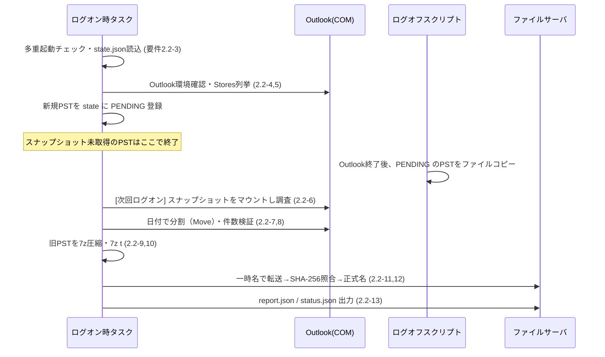
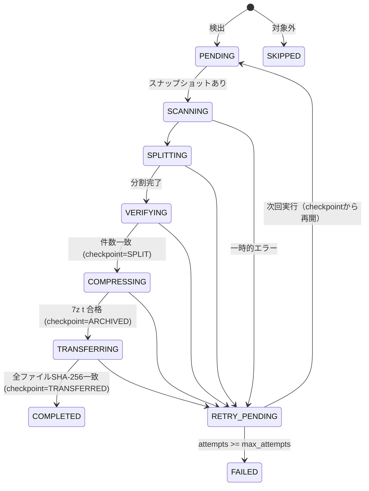

# PSTメールアーカイブ自動収集ツール 設計書

- 文書版数：0.1（初版ドラフト）
- 対象要件：[requirements.md](requirements.md) 版数1.0
- システム名：PSTMigration

---

# 1. 本書の位置づけ

要件定義書（以下「要件」）を実装可能な粒度に落とし込む。特に要件「10. 未決定事項」のうち、実装方式に直結する 10.1（PST処理方式）・10.2（一時ディスク容量）・10.3（実行時間帯）について本書で方式を提案し、確定させる。

## 1.1 既存スクリプト Split-PstByDate.ps1 の扱い

当初は PowerShell スクリプト `Split-PstByDate.ps1` で「新旧PSTへ分割 → 旧PSTをファイルサーバへ永久保存」する計画だったが、要件変更に伴い **本スクリプトは廃止** し、Python製EXEとして再設計する。

## 1.2 本ツールのゴール

本ツールの役目は、**旧メール（7z）と新メール（PST）の両方を、ファイルサーバ `\\192.168.8.120\PSTBackup` に後続作業しやすい形で揃えること** までとする。

| 出力 | 本ツールの到達点 | 後続作業（担当者が別途手作業で実施、スコープ外） |
|---|---|---|
| 旧メール `old_mail_before_20210101_{PC名}.7z` | ファイルサーバに配置・ハッシュ検証済み | SharePoint Online へ移す |
| 新メール `new_mail_from_20210101_{PC名}.pst` | ファイルサーバに配置・ハッシュ検証済み | AzCopy でアップロードし Purview で Exchange Online へインポート |

後続作業を楽にするため、保存先の構造（§8.2）と管理者向け集計出力（§11.4）をそれに合わせて設計する。

既存スクリプトから得た知見と、そのまま流用できない理由：

| 既存実装 | 問題点 | 本設計での対応 |
|---|---|---|
| 元PST上で `MailItem.Copy()` → `Move()` | 元PSTに一時アイテムが作られる。Move失敗時は元PSTの削除済みアイテムにゴミが残る。FR-03違反 | 元PSTには一切書き込まない。スナップショット（ファイルコピー）上で処理する（§4） |
| `Documents\Outlook ファイル` 配下を再帰検索 | FR-01（Outlook Storesから検出）と不一致。保存場所依存 | `Namespace.Stores` から検出（§3） |
| `MailItem.Sent` で送受信を判定 | 受信メールも `Sent = True` になるため、常にSentOn優先になっている | MAPIプロパティで送受信を判定（§5.2） |
| `Class -ne olMail` を全てスキップ | 会議出席依頼・配信通知などが黙って除外される。FR-02違反 | メールフォルダー内のアイテムは原則すべて分割対象（§5.1） |
| アイテムごとにOOMプロパティ参照 | 大容量PSTで低速 | `Folder.GetTable()` で一括走査（§5.3） |
| 出力ファイル名の衝突回避がPC内のみ | 複数PC・同名PSTでサーバ上衝突 | PC名＋パスハッシュでフォルダー分離（§8.2） |

---

# 2. 全体構成

## 2.1 実行形態

1つのEXE `PSTMigration.exe` を、起動引数で3つのモードに切り替える。

| モード | 起動契機 | 起動方法 | 主な処理 | Outlook |
|---|---|---|---|---|
| 通常（引数なし） | ログオン後（遅延） | GPP スケジュールタスク | 検出・調査・分割・圧縮・転送・報告 | 使用 |
| `--snapshot` | ログオフ時 | GPO ログオフスクリプト | 元PSTのファイルスナップショット取得 | 不使用 |
| `--aggregate <root>` | 管理者が手動 | 管理者PCから実行 | サーバ上の status.json を集約し、移行台帳と後続作業向けCSVを `_admin\` に出力（§11.4） | 不使用 |

補助：`--scan-only`（分割せず件数調査のみ。試験・パイロット用）、`--version`。

**ログオフ時にスナップショットを取る理由は §4 を参照。** 結果として、1つのPSTは「ログオン（検出）→ ログオフ（スナップショット）→ 次回ログオン（分割〜転送）」の最短2回のログオンで完了する。

## 2.2 配置

```
%LOCALAPPDATA%\PSTMigration\
    bin\                  GPPファイルで配布（§10.1）
        PSTMigration.exe  7-Zip CLI（7z.exe / 7z.dll）を内蔵。各PCへの7-Zipインストール不要
        config.json
        7-Zip-License.txt
    state.json            PST単位の処理状態（§9）
    logs\
        run-YYYYMMDD-HHMMSS.jsonl
    work\
        {pst_key}\        PSTごとの作業フォルダー（§7）
```

`work_dir` は config で変更可能（システムドライブが小さいPC向け）。OneDriveリダイレクト配下は不可とする。

## 2.3 処理フロー（要件2.2との対応）



## 2.4 モジュール構成（Python）

| モジュール | 責務 |
|---|---|
ソースは `src/pstmigration/`。

| モジュール | 責務 |
|---|---|
| `__main__.py` | 引数解析・モード振り分け・多重起動防止・優先度設定・JSONログ |
| `config.py` | config.json 読込・検証 |
| `state.py` | state.json の原子的読み書き、状態遷移（`StepError`） |
| `rules.py` | Outlook非依存の判定（日付分割、PSTヘッダー、容量計算、集計）。単体テスト対象 |
| `outlook.py` | Outlook接続、PST検出、マウント／アンマウント、調査、分割、件数検証 |
| `pipeline.py` | ログオフ時スナップショット、ログオン時の段階処理（7-Zip呼び出し含む） |
| `transfer.py` | SMB転送、帯域制御、同時転送枠、SHA-256照合 |
| `report.py` | report.json / status.json、`--aggregate` |

依存ライブラリ：pywin32 のみ（標準ライブラリ以外）。テストは `tests/`、ビルドは `scripts/build.sh`（Git Bash）または `scripts/build.bat`（cmd）。

---

# 3. PST自動検出（FR-01）

## 3.1 Outlook接続

1. `win32com.client.Dispatch("Outlook.Application")` で接続（起動中ならそのインスタンス、未起動ならバックグラウンド起動）。
2. `Namespace.Logon("", "", False, False)` — プロファイル選択ダイアログを出さず既定プロファイルを使用。
3. 接続不可（New Outlookのみ・Outlook未導入）→ 全体を `SKIPPED`（理由 `OUTLOOK_UNAVAILABLE`）として status.json のみ出力し終了。

COMはプロセス外サーバのため、EXE（64bit）とOutlook（32/64bit）のビット数は一致不要。EXEは64bit版1種類のみ作成する。

## 3.2 検出条件

`Namespace.Stores` の各 Store について、以下をすべて満たすものを対象とする。

| 条件 | 判定方法 |
|---|---|
| ファイル実体がある | `Store.FilePath` が空でない |
| PST形式 | 拡張子 `.pst`（ヘッダーの最終判定は§4.4でスナップショットに対して行う） |
| IMAP/Exchange以外 | `Store.ExchangeStoreType == olNotExchange(3)` かつ拡張子 `.ost` でない |
| 本ツールの生成物でない | パスが `work_dir` 配下でない、かつファイル名が `*_before_YYYYMMDD.pst` / `*_from_YYYYMMDD.pst`（旧スクリプト出力）に一致しない |

- 一致しないStoreは記録のみ（`SKIPPED`、理由付き）。
- 重複排除キーは `os.path.normcase(os.path.realpath(FilePath))`。
- PSTごとに `pst_key = sha256(正規化パス)[:12]` を採番し、以降の識別に使う。
- `Store.IsDataFileStore` / `Namespace.DefaultStore` との一致（既定データファイルか）も記録する（POP→IMAP移行後、旧POPのPSTが既定データファイルのまま残っているケースが多いと想定）。

## 3.3 起動時の後始末

前回異常終了で作業用PST（`work_dir` 配下）がOutlookに接続されたまま残っている場合、検出前に `RemoveStore` で切り離す。

---

# 4. 元PSTの保護とスナップショット（FR-03／未決定事項10.1）

## 4.1 方式比較

| 方式 | 元PSTへの書き込み | Outlook起動中 | 既定データファイル | 業務影響 | 評価 |
|---|---|---|---|---|---|
| A. 元PST上で `MailItem.Copy()` | **あり**（一時アイテム） | 可 | 可 | 小 | FR-03で禁止 |
| B. ログオン中にファイルコピー | なし | **不可**（Outlookがロック。逆に当方がファイルを掴むとOutlookがPSTを開けなくなる） | 不可 | 大 | 不採用 |
| C. ストア切り離し→コピー→再接続 | なし | 可 | **不可**（既定データファイルは切り離せない） | 中（一時的にナビゲーションから消える。異常終了時に切り離されたまま残る） | 不採用 |
| D. `Folder.CopyTo()` で作業PSTへ複製 | なし（要検証） | 可 | 可 | **大**（大きいフォルダーのコピー中、OutlookのUIスレッドが長時間固まる） | 不採用 |
| E. 拡張MAPIで自プロセスから直接読み出し | なし | 可 | 可 | 小 | 実装・検証コスト大、Officeビット数別にEXEが2種類必要。将来案 |
| **F. ログオフ時にファイルコピー** | **なし** | 該当なし（Outlook終了後） | 可 | 小（ログオフが数分延びる、初回のみ） | **採用** |

## 4.2 採用方式：ログオフ時スナップショット

GPOのログオフスクリプトはユーザーのアプリケーション（Outlook含む）終了後に実行されるため、PSTは誰にもロックされておらず、内容も静止している。この時点でファイルコピーを取り、以降の全処理をコピー上で行う。

`PSTMigration.exe --snapshot` の処理：

1. state.json から `status = PENDING` かつスナップショット未取得のPSTを列挙。
2. 空き容量チェック（§7.2）。不足ならスキップ（`RETRY_PENDING`、理由 `DISK_SPACE`）。
3. 元PSTを `GENERIC_READ` / `FILE_SHARE_READ`（書き込み拒否）で開く。開けない（まだ誰かが使用中）ならスキップ。
4. 開いたハンドルから `work\{pst_key}\snapshot.pst.partial` へコピー。
5. コピー前後でサイズ・最終更新日時が一致することを確認し、`snapshot.pst` へリネーム。
6. state に元PSTのサイズ・更新日時・スナップショット取得日時を記録。

制約：

- ログオフ待ち時間を抑えるため、1回のログオフで処理する合計サイズを `logoff_snapshot_budget_gb` で制限する。超える分は次回ログオフへ回す。
- GPO「グループポリシースクリプトの最大待機時間」（既定600秒）を超えないよう、`logoff_snapshot_budget_gb` は端末のディスク性能に合わせて設定する（HDD端末想定で既定 10GB）。
- 元PSTへの操作は読み取りオープンのみ。元PSTの削除・移動・リネーム・上書きを行うコードパスは存在させない。

## 4.3 弱点と運用での補完

- **ログオフせずスリープ運用を続けるPC** はスナップショットが取れない。月例のWindows Update再起動でログオフが発生するため、通常は1か月以内に取得される。`PENDING` のまま滞留しているPCは台帳（§11.3）で抽出し、管理者から個別にサインアウトを依頼する。
- 滞留が多い場合の追加策として方式E（拡張MAPI）を将来案として残す。

## 4.4 スナップショットの検証

ログオン時、処理開始前に以下を確認する。不合格ならスナップショットを破棄し `RETRY_PENDING`（次回ログオフで再取得）。

- ファイル先頭4バイトが `!BDN`、オフセット8の2バイトが `SM`（PST。`SO` はOSTなので `SKIPPED`）。
- オフセット10の `wVer` を記録（14/15=ANSI、23/36=Unicode）。
- Outlookで `AddStore` によりマウントできること。

スナップショットのマウント中はユーザーのOutlookのナビゲーションウィンドウに表示されるため、マウント直後にルートフォルダー名を `PSTMigration作業中（操作しないでください）` に変更する（スナップショットは作業用コピーなので変更してよい）。出力PSTも同様に命名する。

---

# 5. 調査・日付分割（FR-02、FR-05）

## 5.1 対象範囲

| 対象 | 扱い |
|---|---|
| 既定アイテム種別がメールのフォルダー（`DefaultItemType == olMailItem`）配下のアイテム | 分割対象 |
| 上記のうちメッセージクラスが `IPM.Appointment*` / `IPM.Contact*` / `IPM.DistList*` / `IPM.Task*` / `IPM.StickyNote*` / `IPM.Activity*` | 非メールとして件数記録のみ（分割しない） |
| 予定表・連絡先・タスク・メモ等のフォルダー | 非メールとして件数記録のみ（未決定事項10.5の決定待ち） |
| 検索フォルダー（`PR_FOLDER_TYPE == FOLDER_SEARCH`） | 対象外、記録のみ |

会議出席依頼（`IPM.Schedule.Meeting.*`）・配信／開封通知（`REPORT.*`）・投稿（`IPM.Post`）はメールとして分割対象に含める。

非メールアイテムはスナップショット上に残るだけで、元PSTには残っている。件数を report.json に記録するため「黙って破棄」にはあたらない。

## 5.2 日付判定

OOMの `ReceivedTime` / `SentOn` は、それぞれMAPIプロパティ `PR_MESSAGE_DELIVERY_TIME (0x0E060040)` / `PR_CLIENT_SUBMIT_TIME (0x00390040)` に対応する。メッセージクラスによらず一様に取れるよう、MAPIプロパティで直接取得する。

送受信の区別（要件：受信はReceivedTime優先、送信はSentOn優先）：

| 区分 | 判定 | 優先 | 代替 |
|---|---|---|---|
| 受信 | `PR_TRANSPORT_MESSAGE_HEADERS (0x007D001F)` あり | 配信日時 | 送信日時 |
| 送信・下書き | 上記以外 | 送信日時 | 配信日時 |

下書きは送信日時がなくても配信日時（保存時に付くことが多い）があればそれで分割する。両方なければ未移行（§13 確認事項1）。

- 有効範囲は 1980-01-01〜2100-12-31。範囲外（1601年・4501年などの空値表現）は取得不能とみなす。
- 日付取得不能 → 分割せずスナップショットに残し、`unmigrated` として記録（件名は記録しない。フォルダーパスとメッセージクラスのみ）。
- **タイムゾーン**：MAPIの日時はUTC。基準日時は config の `cutoff`（`2021-01-01T00:00:00+09:00`）をUTC（`2020-12-31T15:00:00Z`）へ変換して比較する。比較は `日時 < cutoff` → 旧、`日時 >= cutoff` → 新。
- 送受信の誤判定の影響は「送信日時と配信日時の差（通常数秒〜数分）」に限られ、基準日時をまたぐ場合のみ結果が変わる。確認用に基準日時 ±24時間のアイテム件数を report.json に記録する。

## 5.3 調査（SCANNING）

スナップショットの各メールフォルダーで `Folder.GetTable("", olUserItems)` を使い、以下の列を一括取得する（アイテムを1件ずつ開かない）。

`EntryID`, `MessageClass`, `PR_MESSAGE_DELIVERY_TIME`, `PR_CLIENT_SUBMIT_TIME`, `PR_MESSAGE_FLAGS`, `PR_TRANSPORT_MESSAGE_HEADERS`（有無判定のみ）, `PR_MESSAGE_SIZE`

結果をフォルダー単位で `work\{pst_key}\scan.json` に保存する。

```json
{
  "folders": [
    {"path": "\\受信トレイ\\取引先A", "old": 1200, "new": 340, "unmigrated": 0,
     "non_mail": 2, "near_cutoff": 3, "old_bytes": 812345678, "new_bytes": 99887766}
  ],
  "totals": {"mail": 1540, "old": 1200, "new": 340, "unmigrated": 0, "non_mail": 2}
}
```

`--scan-only` はここで終了し、report.json を出力する。

## 5.4 分割（SPLITTING）

1. `work\{pst_key}\` に出力PSTを2つ作成（`AddStoreEx(path, olStoreUnicode)`）。
   - `old_mail_before_20210101_{PC名}.pst`
   - `new_mail_from_20210101_{PC名}.pst`
2. スナップショットのフォルダー階層を出力PSTに再現（同名フォルダーがあれば再利用。`削除済みアイテム` は新規PSTに既定で存在する）。
3. 調査結果のEntryIDごとに `GetItemFromID(entry_id, snapshot_store_id).Move(出力フォルダー)`。
   - **Copyではなく Move を使う。** 移動元はスナップショット（使い捨て）なので変更して構わず、`Copy()` の一時アイテム問題自体が発生しない。
   - 100件ごとに `split_pause_ms` 待機し、OutlookのUI応答性を確保する（OOM呼び出しはOutlookのUIスレッドで処理されるため）。
   - COMオブジェクトは1件ごとに解放する。
4. 途中で中断された場合（ログオフ・Outlook終了・強制終了）、次回は既存の出力PSTとスナップショットをそのままマウントし、スナップショットに残っているアイテムを再調査して移動を再開する。Moveは「移動先へコピー→移動元から削除」なので、中断しても欠落はせず、最悪1件重複するだけである（重複は§5.5の検証で検出）。

## 5.5 分割結果の検証（VERIFYING）

フォルダーごとに以下が成立することを確認する（scan.json の値は分割開始前に確定し、以後変更しない）。

```
出力(旧)の件数 = scan.old
出力(新)の件数 = scan.new
スナップショット残存件数 = scan.unmigrated + scan.non_mail
```

- 不一致 → 出力PST・スナップショットを破棄し `RETRY_PENDING`（次回ログオフで再取得）。同一PSTで `max_attempts` 回連続したら `FAILED`。
- 一致 → 出力PSTを `RemoveStore` で切り離し、スナップショットを削除する。
- 切り離し後、Outlookが出力PSTのハンドルを解放するまで最大 `release_wait_sec` 待つ（排他オープンを試行）。解放されなければ状態を保存して終了し、次回ログオン時に続きから実行する。

要件7.3の等式「元PSTの対象メール件数 = 旧 + 新 + 未移行」は、scan.json の `mail = old + new + unmigrated` として report.json に出力する。

## 5.6 大容量の新メールPST（FR-05）

`new_mail_from_20210101_{PC名}.pst` が `new_pst_warn_gb`（既定20GB）を超えた場合、処理は継続し report.json に警告 `NEW_PST_OVER_LIMIT` を記録する。自動再分割は要件どおり追加設計事項とする（年単位で出力PSTを分ける拡張を想定）。

---

# 6. 圧縮（FR-04）

```
7z.exe a -t7z -m0=lzma2 -mx=5 -mmt=2 -bso0 -bsp0 old_mail_before_20210101_{PC名}.7z old_mail_before_20210101_{PC名}.pst
7z.exe t old_mail_before_20210101_{PC名}.7z
```

- 圧縮レベル・スレッド数は config で変更可能（既定 5 / 2）。スレッド数を絞り業務端末の負荷を抑える。
- 7z.exe は低優先度（`BELOW_NORMAL_PRIORITY_CLASS`）で起動する。
- 終了コード 0 以外、または `7z t` 失敗 → 7zファイルを削除して `RETRY_PENDING`。旧PSTは保持する。
- 成功後、7z と 新メールPST の SHA-256 とサイズを state に記録し、旧メールPST（非圧縮）を削除する。
- 新メールPSTは圧縮しない（Purviewインポート用）。
- 旧メールが0件なら 7z を、新メールが0件なら新PSTを作らない（空ファイルを置いても後続作業の邪魔になるだけ）。0件であることは report.json の `counts` で分かる。
- 各PCに7-Zipはインストールされていない前提とし、7-Zip（LGPL）の 7z.exe / 7z.dll を **PSTMigration.exe に内蔵** する（PyInstaller `--add-binary`）。実行時は EXE の展開先（`%TEMP%\_MEIxxxxxx\`）から起動する。ライセンス文書（7-Zip-License.txt）は配布フォルダーに同梱する。

---

# 7. 一時領域管理（FR-10／未決定事項10.2）

## 7.1 作業フォルダー

```
work\{pst_key}\
    snapshot.pst.partial   ログオフ時コピー中
    snapshot.pst           スナップショット
    scan.json              調査結果（分割の正解値）
    old_mail_before_20210101_{PC名}.pst
    new_mail_from_20210101_{PC名}.pst
    old_mail_before_20210101_{PC名}.7z
```

ファイル名と state.json の状態で、どの段階で中断したかを判別できる。

## 7.2 必要空き容量

元PSTサイズを S とする。容量のピークは分割中（スナップショット S ＋ 出力PST合計 最大約1.3S：ANSI→Unicode変換で増える場合を考慮）。

```
必要空き容量 = S × disk_factor（既定 2.5） + disk_reserve_gb（既定 5GB）
```

- スナップショット取得前（ログオフ時）とログオン時処理開始前の2回判定する。
- 不足時は処理を開始しない（`RETRY_PENDING`、理由 `DISK_SPACE`、必要量と空き量を記録）。

## 7.3 削除してよいもの

| ファイル | 削除タイミング |
|---|---|
| snapshot.pst | 分割検証に合格した後 |
| old_mail_before_*.pst | 7z テストに合格した後 |
| *.7z / new_mail_*.pst | サーバ側でSHA-256一致を確認し正式名へリネームした後 |
| 作業フォルダー全体 | `COMPLETED` 後 |
| 元PST | **削除しない（いかなる場合も）** |

---

# 8. ファイルサーバ転送（FR-06）

## 8.1 接続と認証（未決定事項10.4）

保存先：NAS `\\192.168.8.120\PSTBackup`（**AD非参加**）

ドメインユーザーの資格情報では NAS に認証できないため、以下の単純な構成とする。

- NAS にツール専用のローカルアカウント（例 `pstmigration`）を1つ作り、`PSTBackup` に読み書き権限を付ける。
- ツールは起動時に `WNetAddConnection2` で、config の `server_user` / `server_password` を使って共有へ接続する。ドライブ文字は割り当てず、非永続（ログオフで切れる）。
- 接続に失敗しても分割・圧縮は進め、転送時に `NETWORK` エラー（`RETRY_PENDING`）とする。
- ユーザーが同じ NAS に別の資格情報で接続済み（エラー1219）の場合は、その接続のまま試す。
- ユーザーごとのアクセス権は設けない。

**要件からの逸脱（FR-06 アクセス制御）**：パスワードは config.json に平文で入り、全PCと配布場所（NETLOGON）に置かれる。これを読める者は他ユーザーのPSTも参照できる。回収期間に限定した割り切りとし、**回収完了後に NAS 側でアカウントを無効化またはパスワード変更する**。

接続時の注意：

- IP指定・非ドメイン機器のため認証は NTLM。ドメインで送信 NTLM を制限していると接続できない。
- Windows 11 24H2 以降はクライアント側で SMB 署名が必須。NAS 側で SMB 署名を有効にしておく。

## 8.2 保存先構造

```
\\192.168.8.120\PSTBackup\
    users\
        {メールアドレス}\                                    取れなければ {USERNAME}
            {COMPUTERNAME}\
                status.json                         このPC・ユーザーの全PSTの状態（毎回上書き）
                {pst_stem}_{pst_key}_{yyyyMMddHHmmss}\
                    old_mail_before_20210101_{PC名}.7z     → 後で SharePoint へ
                    new_mail_from_20210101_{PC名}.pst      → 後で Purview へ
                    report.json
    _slots\                                         同時転送枠（§8.4）
    _admin\                                         管理者の集計出力（§11.4）
```

- ユーザーフォルダー名は **メールアドレス**（数百人規模で探しやすく、Purview の Mailbox にそのまま使えるため）。ログオン時に次の順で決める：①Outlook のメールアカウントが1つならそのアドレス（IMAP移行後の本人のメールボックス）②AD の `mail` 属性 ③Windows ユーザー名。一度アドレスが取れたら、次回取れなくても前回の値を使う。決め方は status.json の `mailbox_source`（`OUTLOOK` / `AD` / `USERNAME`）に残す。
- 出力ファイル名にもPC名（`%COMPUTERNAME%`）を付ける。同じアカウントで複数PCを使う人がいるため、後続作業でファイルをフォルダーから出しても、どのPC由来か分かるようにする。
- 1つの収集単位（＝元PST 1個分）の旧・新・報告書を同じフォルダーに置く。後続作業で「どのPSTの、何件の、どのファイルか」を report.json で直接確認できる。
- 旧・新ファイルはファイル名で区別できるので、後続作業では拡張子で選んでまとめて扱える（例：AzCopy の `--include-pattern "*.pst"`）。
- `users\` で1階層まとめているのは、管理用フォルダー（`_slots` など）と収集データを分けて扱いやすくするため。
- 要件の例（`user001\` 直下）にPC名と収集単位の階層を追加した。同一ユーザーが複数PCを使う場合や、同名PSTが複数ある場合の衝突を防ぐため（FR-06「ファイルが衝突しない命名規則」）。
- 収集単位フォルダー名の時刻はスナップショット取得時刻。再収集（§9.3）しても別フォルダーになり、既存の収集ファイルを上書きしない。
- 転送中のファイルは `.partial` 付きの名前なので、後続作業の対象に紛れ込まない。後続作業は `report.json` があるフォルダー（＝転送完了済み）だけを対象にする。

## 8.3 転送手順

各ファイル（7z → 新PST の順）について：

1. 転送先に正式名のファイルが既にある → state のSHA-256とサーバ上のファイルを照合。一致なら転送済みとみなし次へ。不一致なら `FAILED`（上書きしない、管理者判断）。
2. `{name}.partial` へ 4MB単位でコピー。既存の `.partial` があればそのサイズから追記再開する（最終的に全体ハッシュで検証するため安全）。
3. 帯域制限：`transfer_max_mbps` を超えないよう各チャンク後に待機（VPN対策）。
4. コピー後、サーバ上の `.partial` を読み直して SHA-256 を計算し、state の値と照合。
   - 不一致 → `.partial` を削除し `RETRY_PENDING`。
5. 一致 → `os.rename` で正式名へ。Windowsの `rename` は既存ファイルを上書きしないため、FR-06「上書きしない」が保証される。
6. 全ファイル完了後、report.json を書き込む（一時名→リネーム）。

ネットワーク断・サーバ停止・権限不足は `RETRY_PENDING`（理由付き）とし、分割・圧縮はやり直さない（FR-08）。

## 8.4 同時転送台数の制御

`\\192.168.8.120\PSTBackup\_slots\` に `slot01.lock` 〜 `slotNN.lock`（空ファイル）を管理者が作成しておく。

- 転送開始前に、いずれかのスロットファイルを **共有モードなし（排他）** で開く。開けたらそのハンドルを保持したまま転送し、終了後に閉じる。
- すべて使用中なら `slot_wait_min` 分まで待機し、だめなら `RETRY_PENDING`（理由 `SLOT_BUSY`）。
- PCが異常終了してもSMBセッション切断でハンドルが閉じるため、ロックが残り続けない。
- 同時台数の変更はスロットファイル数の増減のみで行える。`_slots` が無ければ制限なし。

---

# 9. 状態管理・再実行制御（FR-07、FR-08）

## 9.1 多重起動防止

- 名前付きミューテックス `Global\PSTMigration` を取得できなければ即終了（同一PC上の別ユーザーセッションも含め1インスタンス）。
- タスク設定でも「既に実行中の場合：新しいインスタンスを開始しない」を指定する。

## 9.2 state.json

PSTごとに以下を保持する。書き込みは一時ファイル → `os.replace` で原子的に行う。

```json
{
  "tool_version": "1.0.0",
  "psts": {
    "3f9a1c0d2b7e": {
      "source_path": "C:\\Users\\taro\\Documents\\Outlook ファイル\\Outlook.pst",
      "status": "TRANSFERRING",
      "checkpoint": "ARCHIVED",
      "is_default_store": true,
      "source_size": 5368709120,
      "source_mtime": "2026-10-10T18:02:11+09:00",
      "snapshot_at": "2026-10-13T19:05:40+09:00",
      "folder_counts": {"\\受信トレイ": 15342, "\\送信済みアイテム": 4012},
      "remote_dir": "taro\\PC-0123\\Outlook_3f9a1c0d2b7e_20261013190540",
      "outputs": {
        "old_7z":  {"path": "...", "size": 1234567890, "sha256": "..."},
        "new_pst": {"path": "...", "size": 987654321,  "sha256": "..."}
      },
      "attempts": 1,
      "last_error": {"code": "NETWORK", "message": "...", "at": "..."}
    }
  }
}
```

## 9.3 状態遷移

`status` は要件のステータス定義をそのまま使う。再開位置は別項目 `checkpoint` で持つ。



| checkpoint | 次回再開時の動作 |
|---|---|
| なし | スナップショットがあれば調査から。なければ次回ログオフ待ち |
| SPLIT | 圧縮から（スナップショット不要） |
| ARCHIVED | 転送から（7z・新PSTのサイズ確認のみ。ハッシュは転送時に再計算して照合） |
| TRANSFERRED | report.json 出力のみ |

- 出力ファイルが欠落していたら checkpoint を巻き戻す（例：ARCHIVED なのに 7z が無い → checkpoint をクリアし再収集）。完了扱いにはしない。
- 1回の実行で各PSTは最大1回だけ試行する（実行内ループなし）。
- 一時的エラー（ネットワーク、ディスク容量、Outlook切断、ファイルロック、スロット満杯）は `attempts` を加算しない。決定的エラー（PST破損、件数不一致、7z失敗）のみ加算し、`max_attempts`（既定3）で `FAILED`。
- `FAILED` は自動再試行しない。管理者が原因対応後、`PSTMigration.exe --reset <pst_key>` で `PENDING` に戻す。

### 未移行メールがある場合

日付取得不能などで `unmigrated > 0` のPSTは、取れた分の転送までは行い、最終ステータスを `FAILED`（理由 `UNMIGRATED_ITEMS`、`retryable: false`）とする。要件7.3「未移行0件を正常完了の条件」に従うため。元PSTは残っているので、管理者が個別対応する。

## 9.4 完了済みPSTの変更検出

元PSTの更新日時・サイズは、Outlookにマウントされているだけで変化する（特に既定データファイル）ため、完了判定には使わない。代わりに以下を使う。

- 完了時、メールフォルダーごとのアイテム件数（`folder_counts`）を記録しておく。
- 以降のログオン時、元PST（ライブのStore）について同じ件数を `Folder.Items.Count` で取得して比較する（読み取りのみ）。
- 差分あり →
  - `recollect_on_change = false`（既定）：report に `SOURCE_CHANGED` を記録するのみ。
  - `true`：新しい収集単位として `PENDING` に戻す（別フォルダーへ再収集、既存は残す）。Phase 3直前の最終回収時に管理者がconfigで切り替えて使う想定。

> ponytail: 件数比較のみなので「同一フォルダーで1件削除＋1件追加」は検出できない。必要になったら最終更新日時の最大値も比較に加える。

---

# 10. GPO配布・自動実行（FR-09／未決定事項10.3）

## 10.1 配布

ユーザーの構成 → 基本設定 → Windowsの設定 → ファイル（操作：置換。「更新」は既存ファイルを上書きしないため、バージョンアップが配られない）

| 配布元 | 配布先 |
|---|---|
| `\\<ドメイン名>\NETLOGON\PSTMigration\*` | `%LOCALAPPDATA%\PSTMigration\bin\` |

- 配布元は NETLOGON とする。NAS は AD 非参加でドメインユーザーが読めないため、GPPファイルの配布元にできない（§8.1）。

- EXEは PyInstaller の **onefile** でビルドし（7-Zip CLI 内蔵）、`PSTMigration.exe` / `config.json` / `7-Zip-License.txt` をフラットに配置する（GPPファイルはサブフォルダーを再帰コピーできないため）。ビルドは `scripts/build.sh` または `scripts/build.bat`。
- AppLocker / ソフトウェア制限ポリシーで `%TEMP%` 配下のEXE実行を禁止している場合、内蔵の 7z.exe が起動できない。その場合はビルド時に PyInstaller `--runtime-tmpdir` で展開先を変更する。
- 配布元に `SHA256SUMS.txt` を置き、リリース時に管理者がハッシュを記録・照合する（4.3 改ざん対策）。
- ESETの検知（PyInstaller onefile は誤検知されやすい）はパイロットで確認する。誤検知時はESET側で当該ハッシュを除外登録する（監視機能自体は無効化しない）。

## 10.2 ログオン時タスク

ユーザーの構成 → 基本設定 → コントロールパネルの設定 → スケジュールされたタスク → スケジュールされたタスク（Windows 7以降）

| 項目 | 設定 |
|---|---|
| GPP の操作 | **作成**（「更新」はポリシー処理のたびにタスクを再登録し、遅延中のログオン トリガーが消えるため不可。パイロットで確認） |
| ユーザーアカウント | `%LogonDomain%\%LogonUser%` |
| セキュリティオプション | ユーザーがログオンしているときのみ実行する |
| トリガー | ログオン時、遅延 30分 |
| 操作 | `%LOCALAPPDATA%\PSTMigration\bin\PSTMigration.exe` |
| 既に実行中の場合 | 新しいインスタンスを開始しない |
| 停止条件 | 「長時間実行されている場合は停止する」をオフ |
| 電源 | 「AC電源の場合のみ開始する」をオフ |

- EXEは起動直後に自身を `BELOW_NORMAL_PRIORITY_CLASS` ＋ `PROCESS_MODE_BACKGROUND_BEGIN`（I/O優先度も低下）に設定する。
- コンソールウィンドウは出さない（PyInstaller `--noconsole`）。画面・ダイアログは一切表示しない。

## 10.3 ログオフスクリプト

ユーザーの構成 → ポリシー → Windowsの設定 → スクリプト → ログオフ

```
スクリプト名:   cmd.exe
パラメーター:   /c cd /d "%LOCALAPPDATA%\PSTMigration\bin" && if exist PSTMigration.exe start "" /wait PSTMigration.exe --snapshot
```

`cmd.exe` を挟むのは、環境変数を確実に展開するためと、ウィンドウのない EXE の終了を `start /wait` で待たせるため（待たないとログオフが先に進み、コピー途中で終了させられる）。
`if exist` で EXE の存在を確認する。未配布のPCで `start` すると非表示のエラーダイアログで待ち続け、サインアウトがスクリプト待機上限まで止まるため（パイロットで発生）。

コンピューターの構成「グループポリシースクリプトの最大待機時間」は既定（600秒）のままとし、`logoff_snapshot_budget_gb` で処理量を抑える。

## 10.4 Outlookのセキュリティ警告

本ツールが使うOOM操作（Table取得、PropertyAccessor、Move）はOutlookのオブジェクトモデルガードの対象になり得る。ESETがWindowsセキュリティセンターに正常登録されていれば警告は出ないが、出る場合はGPO（Office管理用テンプレート）「プログラムによるアクセスのセキュリティ」で対処する。パイロットで確認する。

---

# 11. ログ・報告（FR-07）

## 11.1 出力先

| 種別 | 場所 | 形式 | 内容 |
|---|---|---|---|
| 実行ログ | `%LOCALAPPDATA%\PSTMigration\logs\run-*.jsonl` | JSON Lines | イベント単位（段階開始・終了・エラー・例外スタック） |
| PST報告 | ローカル work と サーバ収集単位フォルダーの `report.json` | JSON | PST単位の結果（§11.2） |
| PC状態 | サーバ `users\{メールアドレス}\{COMPUTER}\status.json` | JSON | このPC・ユーザーの全PSTの state 要約。毎回上書き。転送前に失敗したPSTも管理者が把握できるようにするため |
| 移行台帳ほか | 管理者が `--aggregate` で `_admin\` に生成 | CSV（UTF-8 BOM付き） | 全 status.json を1行=1PSTで集約。後続作業向けCSVも出力（§11.4） |

ローカルログは30日経過分を起動時に削除する。

## 11.2 report.json 項目（要件FR-07記録項目との対応）

| 要件の記録項目 | キー |
|---|---|
| 実行日時 | `started_at`, `finished_at` |
| コンピューター名 | `computer` |
| Windowsユーザー名 | `user` |
| ツールバージョン | `tool_version` |
| 元PSTパス／サイズ | `source.path`, `source.size` |
| 処理対象メール件数 | `counts.mail` |
| 2020年以前／2021年以降 | `counts.old`, `counts.new` |
| コピー成功件数 | `counts.moved_old + counts.moved_new` |
| スキップ件数 | `counts.non_mail`, `counts.search_folder_items` |
| エラー件数 | `counts.unmigrated`, `errors[]` の件数 |
| 圧縮前容量／圧縮後容量／圧縮率 | `archive.pst_size`, `archive.size`, `archive.ratio` |
| 転送先 | `remote_dir` |
| SHA-256 | `outputs.*.sha256` |
| 処理時間 | `durations.{scan,split,compress,transfer}_sec` |
| 最終ステータス | `status` |
| エラー詳細 | `errors[]`（`code`, `phase`, `folder`, `message_class`, `message`） |

追加：`is_default_store`, `pst_format`（ANSI/Unicode）, `counts.near_cutoff`, `warnings[]`, `folders[]`（フォルダー別件数）。

個人情報：件名・送信者・本文は記録しない（config `log_subject` を true にした場合のみ、エラー対象アイテムの件名を記録。障害解析用）。フォルダーパスは記録する。

## 11.3 移行台帳CSVの列

`mailbox, mailbox_source, user, computer, pst_key, source_path, is_default_store, status, checkpoint, last_error_code, mail, old, new, unmigrated, non_mail, new_pst_size, archive_size, remote_dir, warnings, updated_at, tool_version`

`status = PENDING` かつ `updated_at` が古いものは「ログオフされずスナップショット未取得」の候補として抽出する。

## 11.4 後続作業向けの出力（`--aggregate`）

`PSTMigration.exe --aggregate \\192.168.8.120\PSTBackup` を管理者が実行すると、`_admin\` に以下を出力する。後続作業の準備をこのツールで済ませておくためのもの。

| ファイル | 内容 | 使い道 |
|---|---|---|
| `ledger.csv` | 移行台帳（§11.3） | 回収状況の把握・未完了PCの洗い出し |
| `purview_mapping_draft.csv` | `COMPLETED` の新メールPSTごとに1行。Purview PSTインポートのマッピングCSV形式（`Workload,FilePath,Name,Mailbox,IsArchive,TargetRootFolder,...`）。`FilePath` は `users/{メールアドレス}/{PC}/{収集単位}`、`Name` は `new_mail_from_20210101_{PC名}.pst`、`Mailbox` はフォルダー名のメールアドレス、`TargetRootFolder` は `/POP移行メール` | Purviewインポート時のマッピングCSVのたたき台。アドレスが取れなかった行は `Mailbox` 空欄・備考 `MAILBOX_UNKNOWN` とし、担当者が記入する |
| `archive_list.csv` | `COMPLETED` の旧メール7zごとに1行（ユーザー、PC、パス、サイズ、SHA-256、件数） | SharePointへ移した後の突き合わせ（件数・ハッシュ） |

- AzCopy でアップロードする際は `users\` を起点に `--include-pattern "*.pst"` を指定すれば、新メールPSTだけがマッピングCSVの `FilePath` と同じ相対パスでアップロードされる。
- 同一ユーザーに収集単位が複数ある場合（複数PST・複数PC・再収集）は、`purview_mapping_draft.csv` の備考列に `MULTIPLE_UNITS` と出す。インポート対象を担当者が選ぶ。

---

# 12. 設定ファイル config.json（4.4 保守性）

| キー | 既定値 | 説明 |
|---|---|---|
| `cutoff` | `"2021-01-01T00:00:00+09:00"` | 日付分割基準 |
| `server_root` | `"\\\\192.168.8.120\\PSTBackup"` | 転送先 |
| `server_user` / `server_password` | `"pstmigration"` / `""` | NAS のローカルアカウント（§8.1）。`server_user` が空なら接続処理をしない |
| `work_dir` | `"%LOCALAPPDATA%\\PSTMigration\\work"` | 作業フォルダー |
| `disk_factor` | `2.5` | 必要空き容量の係数（§7.2） |
| `disk_reserve_gb` | `5` | 必要空き容量の余裕分 |
| `logoff_snapshot_budget_gb` | `10` | 1回のログオフで取るスナップショット合計上限 |
| `split_pause_ms` | `200` | 分割時、100件ごとの待機 |
| `release_wait_sec` | `900` | 出力PSTのハンドル解放待ち |
| `sevenzip_level` | `5` | 圧縮レベル |
| `sevenzip_threads` | `2` | 圧縮スレッド数 |
| `transfer_max_mbps` | `50` | 転送帯域上限 |
| `slot_wait_min` | `30` | 転送スロット待ち上限 |
| `new_pst_warn_gb` | `20` | 新メールPSTの警告サイズ |
| `max_attempts` | `3` | 決定的エラーの再試行上限 |
| `recollect_on_change` | `false` | 完了後に元PSTが変わったら再収集するか |
| `log_subject` | `false` | エラー時に件名を記録するか |

config は起動時に検証し、不正なら何もせずログに記録して終了する。

---

# 13. 要件定義書への確認事項

実装前に確認したい点。括弧内は確認が取れない場合の本設計の扱い。

1. **未送信の下書きの扱い**：下書きには送信日時がない。配信日時があればそれで分割するが、両方ない下書きは要件どおり「日付取得不能＝未移行」となり、そのPSTは正常完了にならない。最終更新日時で判定する、または移行対象外とすることを提案する。（現実装は要件どおり未移行として扱う。パイロットで件数を確認）
2. **ログオフ時スナップショットの採用可否**：ログオフが初回のみ数分延びる。周知文に含める必要がある。（採用）
3. **サーバ保存先の階層追加**：要件例 `user001\` 直下ではなく `users\{メールアドレス}\{PC名}\{PST単位}\` とする。（§8.2のとおり）
4. **未移行メールがあるPSTのステータス**：取れた分は転送したうえで `FAILED` としている。要件のステータス定義に「一部完了」がないため。（`FAILED`＋理由コード）
5. **予定表・連絡先等**：分割の対象外（件数記録のみ）。連絡先だけは、ログオン時のたびに全ストア（Exchange 除く）の連絡先フォルダーを `Folder.CopyTo` で `contacts_{PC名}.pst` にまとめ、NAS の `users\{メールアドレス}\{PC名}\` 上を置き換える（日付で分けない最新バックアップ。件数は元とコピー先で照合）。予定表・タスク等は未決定のまま。
6. **要件定義書「12. 最終方針」が途中で切れている**（「各PCに分散した」で終わっている）。

## 13.1 後続作業への申し送り（本ツールのスコープ外）

ファイルサーバに揃えた後の作業手順の目安。

**新メール → Exchange Online（Purview）**
1. `--aggregate` で `purview_mapping_draft.csv` を出力し、`Mailbox` 列を確認する（`MAILBOX_UNKNOWN` の行は記入）。`MULTIPLE_UNITS` の行はどれをインポートするか決める。
2. AzCopy で `users\` を `--include-pattern "*.pst"` 付きでアップロードする。
3. マッピングCSVでインポートジョブを作成する。`TargetRootFolder` は `/POP移行メール` のままにすることを推奨する。出力PSTの `受信トレイ` などがメールボックスの既定フォルダーに混ざらず、IMAP移行分との重複確認（要件5.3）もしやすい。

**旧メール → SharePoint Online**
1. `users\` 配下の `*.7z` と `report.json` を収集単位フォルダーごと移す（report.json に件数・ハッシュがあるため、アーカイブとして一緒に残す価値がある）。
2. 移した後、`archive_list.csv` のサイズ・SHA-256 と突き合わせる。

---

# 14. テスト設計（要件7章との対応）

## 14.1 方式検証（実装着手前に実施）

本設計の前提のうち、実機確認が必要なもの。

| No | 検証内容 | 合格条件 |
|---|---|---|
| P1 | ログオフスクリプト実行時点でOutlookが終了しPSTが排他オープン可能か | 4バージョン（2016/2019/2024/M365）すべてで可 |
| P2 | 元PSTがマウント中のプロファイルに、そのスナップショットを追加マウントできるか | 両方のストアが別物として扱われ、EntryIDで正しく取得できる |
| P3 | `RemoveStore` 後に出力PSTのハンドルが解放されるまでの時間 | `release_wait_sec` 以内 |
| P4 | Table・PropertyAccessor・Move でオブジェクトモデルガード警告が出ないか（ESET環境） | 警告なし |
| P5 | 10GB級PSTの分割中、Outlookの通常操作に体感上の支障がないか | `split_pause_ms` 調整で許容範囲 |
| P6 | PyInstaller onefile EXE が ESET に検知されないか | 検知なし、または除外登録で解消 |

## 14.2 機能・障害・整合性テスト

要件7.1〜7.3の各項目は、下表の観点で試験する。

| 要件の試験項目 | 本設計での確認ポイント |
|---|---|
| 単一／複数PSTの検出、IMAPストアの除外 | §3.2の条件、OSTが SKIPPED になること |
| 同名PSTの衝突防止 | 別フォルダーの同名PST・2台のPCで同一パスのPSTがサーバ上で別フォルダーになる |
| 送受信メールの日付判定、境界判定 | 2020-12-31 23:59:59 JST と 2021-01-01 00:00:00 JST の受信・送信メールを用意。送信日時と配信日時が境界をまたぐメールも用意 |
| 日付取得不能メール | unmigrated に計上され、FAILED（UNMIGRATED_ITEMS）になる |
| 空フォルダー・多階層フォルダー | 出力PSTに同じ階層が再現される |
| 7z圧縮・展開、転送後ハッシュ一致 | 展開したPSTをOutlookで開き件数一致 |
| 完了済みPSTの再処理防止 | 2回目のログオンで COMPLETED のまま、サーバに変化なし |
| Outlook起動中／終了中 | 起動中：既存インスタンスを使用。終了中：バックグラウンド起動しダイアログが出ない |
| PSTアクセス失敗・PST破損 | 破損PSTは §4.4 で検出し FAILED（max_attempts後）。元PSTは不変 |
| ディスク空き容量不足 | 処理開始前に RETRY_PENDING（DISK_SPACE） |
| ネットワーク切断・サーバ停止・転送途中の強制終了 | `.partial` から再開し、最終的にハッシュ一致。分割・圧縮はやり直さない |
| ログオフ・シャットダウン・再ログオン | 分割途中で中断→再開後に件数一致 |
| 同時起動 | 2つ目のプロセスが即終了 |
| 圧縮失敗 | 7zを削除し旧PSTを保持して RETRY_PENDING |
| 転送先権限不足・NASパスワード誤り | 分割・圧縮は進み、転送で RETRY_PENDING（NETWORK / ACCESS_DENIED） |
| 元PSTの完全性 | 処理前後で元PSTのフォルダー別件数が一致。元PST内に「コピー」アイテムや削除済みアイテムの増加がないこと |

自動テスト：日付判定（§5.2）、状態遷移（§9.3）、必要容量計算（§7.2）、転送の再開・ハッシュ照合（§8.3、ローカルフォルダーをSMB代わりにして実施）は Outlook 不要の単体テストとして用意する。

---

# 15. 要件トレーサビリティ

| 要件 | 本書 |
|---|---|
| FR-01 PST自動検出 | §3 |
| FR-02 日付分割 | §5.1〜5.5 |
| FR-03 元PSTの保護 | §4、§7.3 |
| FR-04 旧メールPSTの圧縮 | §6 |
| FR-05 新メールPSTの生成 | §5.4、§5.6 |
| FR-06 ファイルサーバ転送 | §8 |
| FR-07 ログ・処理結果管理 | §9.2、§11 |
| FR-08 再実行制御 | §9 |
| FR-09 GPO配布・自動実行 | §10 |
| FR-10 一時領域管理 | §7 |
| 4.1 性能 | §5.4（待機）、§6（スレッド・優先度）、§8.3（帯域）、§8.4（同時台数）、§10.2（優先度） |
| 4.2 可用性 | §5.4（再開）、§8.3（再開）、§9 |
| 4.3 セキュリティ | §4.2、§8.1、§10.1、§10.4、§11.2 |
| 4.4 保守性 | §2.4、§12 |
| 10.1 PST処理方式 | §4.1 |
| 10.2 一時ディスク容量 | §7.2 |
| 10.3 実行時間帯 | §2.1、§10.2、§10.3 |
| 10.4 ファイルサーバ | §8.1、§8.4 |
